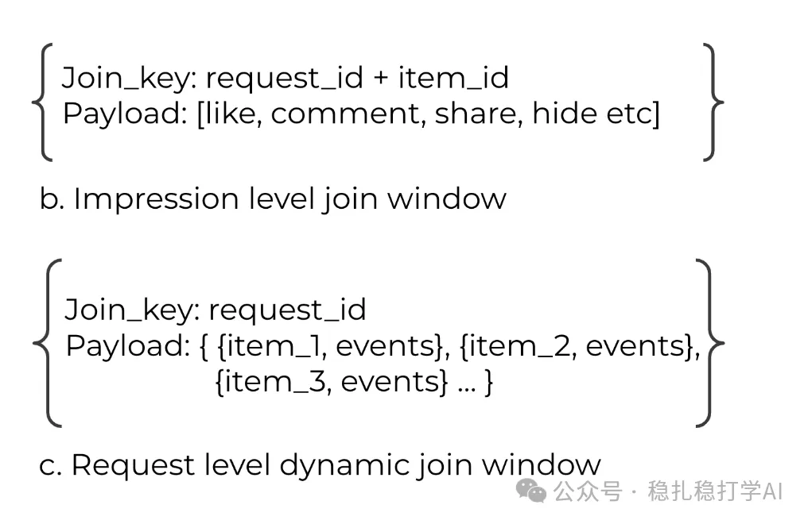

# 推荐算法(2025.8.11)：Meta为落地生成式推荐，重构样本格式

> 原文：https://mp.weixin.qq.com/s/e3ndSbvLRIMxPsP7YkHdIw
> 作者：算法工程师刘明星（稳扎稳打学AI）| 发表于 2025-08-11

嘿，记得给“稳扎稳打学AI”添加星标

关注我，每天为你精挑细选最优质、最新鲜的推荐算法paper，陪你一起保持进步、不断精进！

👆 [本公众号paper推荐原则](https://mp.weixin.qq.com/s/BhVGu0qH5kTz9N5zpsD3KA)

1 Request-Only Optimization for Recommendation Systems

网址：https://arxiv.org/pdf/2508.05640

公司：Meta

方向：样本格式

解读：

为了让生成式推荐模型的落地，调整样本格式，每个样本从一个曝光变成一次请求。

直接的好处：

（1）减少冗余

这样，一次请求是同一个用户，那么用户信息就不用重复存储了，从而节省了存储空间。

（2）方便压缩

一个请求样本可以分成两部分：RO (Request-Only)部分（用户侧特征）和NRO (Non-Request-Only)部分（物品侧特征），方便使用列式存储，提升压缩比。

间接的好处：

（1）HSTU模型的复杂度提升

3方面，第一是允许HSTU的全面落地，第二是，用户行为序列的长度变大，第三是模型的深度增加。

HSTU已经证明了其效果，只是苦于效率不够而不能全面部署；序列变成、模型变大，可以提高模型效果，已经被广泛证明了。

（2）样本量

之前是抽样，现在可以用全量样本。样本增多，从而提升模型效果。

AB：Meta在召回、粗排、精排都拿到了效果。这里只写召回的，其它的看paper。主要在线消费指标提升了 4.77%。

心得：

（1）为落地生成式推荐，各个公司使出浑身解数。

（2）Meta这个工作有其必然性，之前没有使用全部样本，必然想法子将所有样本用上。

可信度：生产

推荐等级：有实践价值

请帮忙点赞、转发，谢谢。您认为哪篇论文最有潜力应用到实际业务中？

## 欢迎干货投稿 \ 论文宣传 \ 合作交流

推荐您继续阅读：

[推荐算法(2025.8.7)：欧洲电商，双塔召回，效果还不错](https://mp.weixin.qq.com/s/d1z5bxjKgH1wlfCoQSrFVQ)

[推荐算法(2025.8.6)：eBay双塔，小小的LLM应用，开出大大的花](https://mp.weixin.qq.com/s/bRxQ16v9qLVRzcvamWGZ6A)

[推荐算法(2025.8.5)：淘宝的物料冷启动，使用“群组信息增强”取得巨大效果](https://mp.weixin.qq.com/s/92DARCpzTOZCX-UTgz29Eg)

历史文章索引：https://docs.qq.com/sheet/DYXZTZ0tseHRyZGtt?tab=BB08J2

请入微信群，群内我会给出更深入的解读，还可以共同讨论技术方案、发招聘广告、内推和交友等。

铁粉标准：关注一个月以上，且累计10次互动（评论、爱心、转发）、投稿1次。

入群方法：请您加个人微信lmxhappy，我拉您入群，请备注（只我个人看，不公开）。

由于公众号试行乱序推送，您可能不再准时收到稳扎稳打学AI的推送。为了第一时间收到本号的干货内容， 请将本号设为星标，以及常点文末右下角的“在看”。

喜欢的话点个在看吧👇

个人观点，仅供参考
