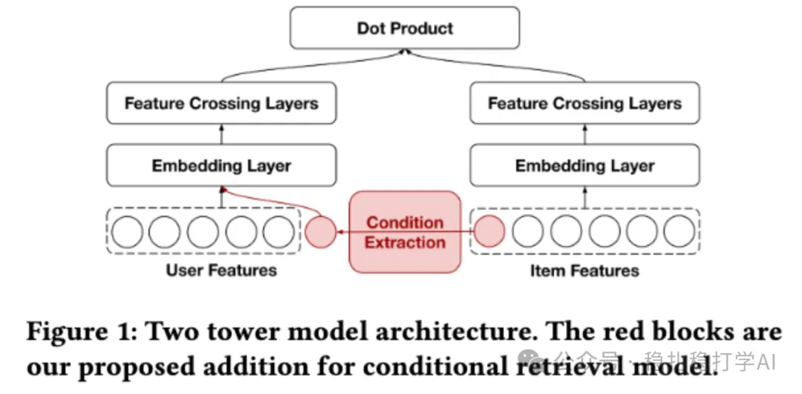

# Daily pick (2025.8.29): Pinterest's embedding enhancement 2.0, simple and effective

> [中文版](2025-08-29-pinterest-embed-enhance-2.md)

1 Multi-Faceted Large Embedding Tables for Pinterest Ads Ranking

Link: https://arxiv.org/pdf/2508.05700

Company: Pinterest

Area: embedding optimization

Overview:

ID features are not learned from scratch through the embedding layer. Instead, their embeddings are learned separately by other models, added into the main model, and fine-tuned there; in other words, they share weights with the main model.

This is Pinterest's second paper on embeddings. Besides the minimal dot-product model from the first paper, it also learns another set of ID embeddings for different objects through a knowledge graph. These two sets of IDs are added to the main model. The main model no longer adds ID features on its own (representations obtained through the embedding layer). Specifically:

(1) User-Pin Contrastive Learning (Figure 2): pretrain User and Pin ID embedding tables on historical click/conversion data. The goal is to capture user-item interactions independently, avoiding interference from other features; it uses a contrastive loss (in-batch + out-of-batch negatives) and brings in longer history data. For details, see my earlier note "Daily pick (2025.8.28): Pinterest's embedding warm-up method, simple and effective".

(2) Large-scale Heterogeneous Knowledge Graph Embedding (Figure 3): build a heterogeneous graph with hundreds of millions of nodes/edges (nodes such as User, Pin, Ad; edges such as click, shop), and pretrain multiple kinds of ID embeddings via a link prediction task. Unlike GCN methods (such as GraphSage), KGE captures additional information and provides complementary (orthogonal) gains.

The framework has been deployed in Pinterest's ads system, bringing a 1.34% online CPC reduction and a 2.60% CTR increase.

Takeaways:

(1) Pinterest has used graph-based methods to learn embeddings for a long time and applied them across scenarios; it's what they're good at. PinSage is one example.

(2) Pinterest has firmly committed to learning ID embeddings out of band. That's because they found this approach works.

Credibility: production

Recommendation: practically useful

