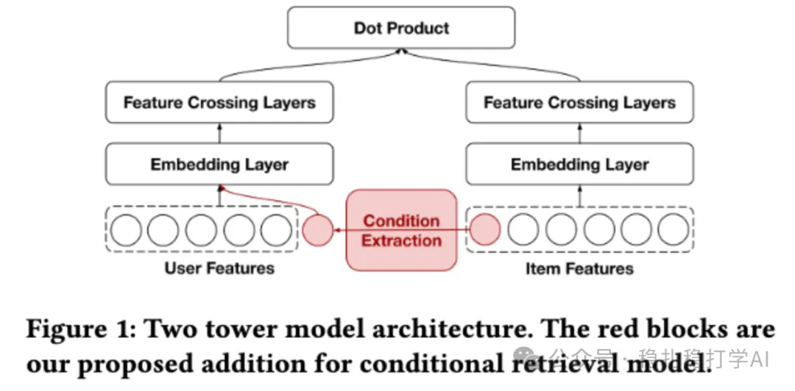

# 推荐算法(2025.8.29)：Pinterest的Embed增强2.0，简单有效

> 原文：https://mp.weixin.qq.com/s/u2VPDCyET_1Fj6SnFRwy6w
> 作者：算法工程师刘明星（稳扎稳打学AI）| 发表于 2025-08-29（标题已修改；修改于2025年8月31日）

嘿，记得给“稳扎稳打学AI”添加星标

关注我，每天为你精挑细选最优质、最新鲜的推荐算法paper，陪你一起保持进步、不断精进！

> [English version](2025-08-29-pinterest-embed-enhance-2.full.en.md)

👆 [本公众号paper推荐原则](https://mp.weixin.qq.com/s/BhVGu0qH5kTz9N5zpsD3KA)

1 Multi-Faceted Large Embedding Tables for Pinterest Ads Ranking

网址：https://arxiv.org/pdf/2508.05700

公司：Pinterest

方向：Embed优化

解读：

ID类特征不是通过embedding layer从0学习，而是通过其它模型另外学习它们的embed，并加入到主模型中，并在其中做微调，换句话说，它们与主模型共享weights。

这是Pinterest的Embed的第二篇paper，除了使用了第一篇paper提到的最小点积模型，还通过knowledge graph学习到不同object的ID的另外一套embedding。这两套ID，加入到主模型。主模型不再添加ID类特征（通过embedding layer获得表征）。具体的，

（1）User-Pin对比学习（User-Pin Contrastive Learning，Figure 2）：使用历史点击/转化数据预训练User和Pin ID嵌入表。目标是独立捕捉用户-物品互动，避免与其他特征干扰；使用对比损失（in-batch + out-batch负样本），融入更长历史数据。详情参考 [推荐算法(2025.8.28)：Pinterest的Embed预热方法，简单有效](https://mp.weixin.qq.com/s/EI8CfgZ4EH7sGWs3LwuBNQ)

（2）大规模异构知识图嵌入（Heterogeneous Knowledge Graph Embedding，Figure 3）：构建包含数亿节点/边的异构图（节点如User、Pin、Ad；边如click、shop），通过链接预测任务预训练多种ID嵌入。不同于GCN方法（如GraphSage），KGE捕捉额外信息，提供互补获益（orthogonal gains）。

该框架已在Pinterest广告系统中部署，带来1.34%的在线CPC降低和2.60%的CTR增加。

心得：

（1）Pinterest很早就用graph-based方法学习embed，并用在各个场景，这是他们擅长的事情。比如，PinSage等。

（2）Pinterest已经很坚决的，带外学习ID类的embed。这是发现了这种方法work。

可信度：生产

推荐等级：有实践价值

请帮忙点赞、转发，谢谢。您认为哪篇论文最有潜力应用到实际业务中？

## 欢迎干货投稿 \ 论文宣传 \ 合作交流

推荐您继续阅读：

■ [推荐算法(2025.8.28)：Pinterest的Embed预热方法，简单有效](https://mp.weixin.qq.com/s/EI8CfgZ4EH7sGWs3LwuBNQ)

■ [推荐算法(2025.8.27)：Pinterest的条件召回，简单有效](https://mp.weixin.qq.com/s/iwYRuGuSWo4AsEAyxkY5TA)

历史文章索引：https://docs.qq.com/sheet/DYXZTZ0tseHRyZGtt?tab=BB08J2

请入微信群，群内我会给出更深入的解读，还可以共同讨论技术方案、发招聘广告、内推和交友等。

• 铁粉标准：关注一个月以上，且累计10次互动（评论、爱心、转发）、或投稿1次。

• 入群方法：请您加个人微信lmxhappy，我拉您入群，请备注（只我个人看，不公开）。

喜欢的话点个在看吧👇

个人观点，仅供参考

修改于2025年8月31日
