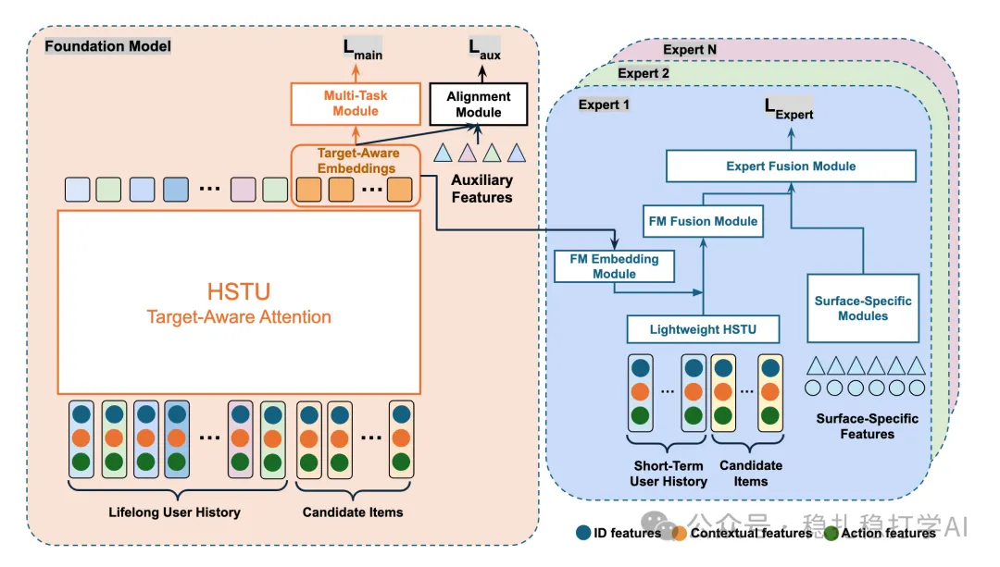

# Daily pick (2025.9.1): Meta's foundation + expert models

> [中文版](2025-09-01-meta-foundation-expert.md)

1 Realizing Scaling Laws in Recommender Systems: A Foundation–Expert Paradigm for Hyperscale Model Development

Link: https://arxiv.org/pdf/2508.18834

Company: Meta

Area: foundation + expert

Overview:

Using multimodal data collected across its platforms and scenarios, Meta tries, as in CV and NLP, to build a foundation base model and then build a small model for each scenario on top of it, aiming to unleash the power of scaling laws in recommendation.

Concretely: a foundation model learns general knowledge from lifelong behavior sequences and multi-scenario, multimodal user data, and the candidate item embeddings it learns are then fused into lightweight, scenario-specific expert models to improve them.

An HSTU (Hierarchical Sequential Transduction Units) model is trained with a multi-task, multi-label loss, including a main loss (cross-scenario tasks such as like, share, video completion) and auxiliary losses (scenario-specific tasks, computed only on valid samples).

During training, the candidate item's embedding as the target item is "materialized" and logged as a candidate-item-level feature, stored in the training data. This is an offline process that only generates embeddings for a small subset of served items, with relaxed latency requirements. The experts consume these precomputed embeddings directly as input features during training, decoupling the foundation model from the experts and avoiding the overhead of joint training.

Takeaways:

(1) A large amount of engineering work was needed to get this into production.

(2) Meta has many business lines and scenarios, and wants to pool all the data to train one model, get high-quality item embeddings, and then customize models for each scenario with little effort. That goal is very tempting. Even a small app has data from multiple scenarios, and also has a shot at turning all that data into a foundation model.

Credibility: production

Recommendation: practically useful, worth a look

