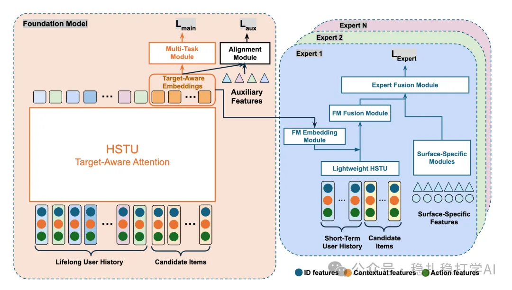

# 推荐算法(2025.9.1)：Meta的底座+专家

> 原文：https://mp.weixin.qq.com/s/h0vr5j0X4hBgDc8PXDohJg
> 作者：算法工程师刘明星（稳扎稳打学AI）| 发表于 2025-09-01（标题已修改；修改于2025年9月1日）

嘿，记得给“稳扎稳打学AI”添加星标

关注我，每天为你精挑细选最优质、最新鲜的推荐算法paper，陪你一起保持进步、不断精进！

👆 [本公众号paper推荐原则](https://mp.weixin.qq.com/s/BhVGu0qH5kTz9N5zpsD3KA)

1 Realizing Scaling Laws in Recommender Systems: A Foundation–Expert Paradigm for Hyperscale Model Development

网址：https://arxiv.org/pdf/2508.18834

公司：Meta

方向：底座+专家

解读：

Meta试图通过各个平台、场景搜集的多模态数据，就像CV、NLP领域一样，打造一个基础base模型，在其之上，为各个场景建一个小的模型，试图在推荐算法上释放出缩放定律的强大作用。

具体。用一个基础模型从终身行为序列、多场景、多模态用户数据中学习通用知识，然后将学到的candidate item的嵌入，fusion到轻量级、特定场景的专家模型上，提升其效果。

训练HSTU（Hierarchical Sequential Transduction Units）模型，多任务多标签损失，包括主损失（跨场景任务，如点赞、分享、视频完成）和辅助损失（场景特定任务，仅在有效样本上计算）。

训练的时候，candidate item作为target item的embedding，被“materialized”（物化）并日志记录作为候选物品级特征，存储在训练数据中。这是一个离线过程，仅针对服务物品的小子集生成入，具有宽松的延迟要求。专家训练时直接消费这些预计算的嵌入作为输入特征，实现基础模型和专家的解耦，避免联合训练的开销。

心得：

（1）在工程上做了大量的工作，才能落地。

（2）meta业务线、场景都很多，希望将所有数据都集中起来，训练一个模型，获得优质的item的embed，然后在各个场景用小的力气定制模型。这个目标很有诱惑力。即使小APP，也有多个场景的数据，也有将所有数据打造成底座模型的希望。

可信度：生产

推荐等级：有实践看看

请帮忙点赞、转发，谢谢。您认为哪篇论文最有潜力应用到实际业务中？

## 欢迎干货投稿 \ 论文宣传 \ 合作交流

推荐您继续阅读：

■ [推荐算法(2025.8.30)：微软的语义embed对齐，简单有效](https://mp.weixin.qq.com/s/aFfTgavsGzsvU9j5XYianw)

■ [推荐算法(2025.8.29)：Pinterest的Embed增强2.0，简单有效](https://mp.weixin.qq.com/s/u2VPDCyET_1Fj6SnFRwy6w)

历史文章索引：https://docs.qq.com/sheet/DYXZTZ0tseHRyZGtt?tab=BB08J2

请入微信群，群内我会给出更深入的解读，还可以共同讨论技术方案、发招聘广告、内推和交友等。

• 铁粉标准：关注一个月以上，且累计10次互动（评论、爱心、转发）、或投稿1次。

• 入群方法：请您加个人微信lmxhappy，我拉您入群，请备注（只我个人看，不公开）。

喜欢的话点个在看吧👇

个人观点，仅供参考

修改于2025年9月1日
