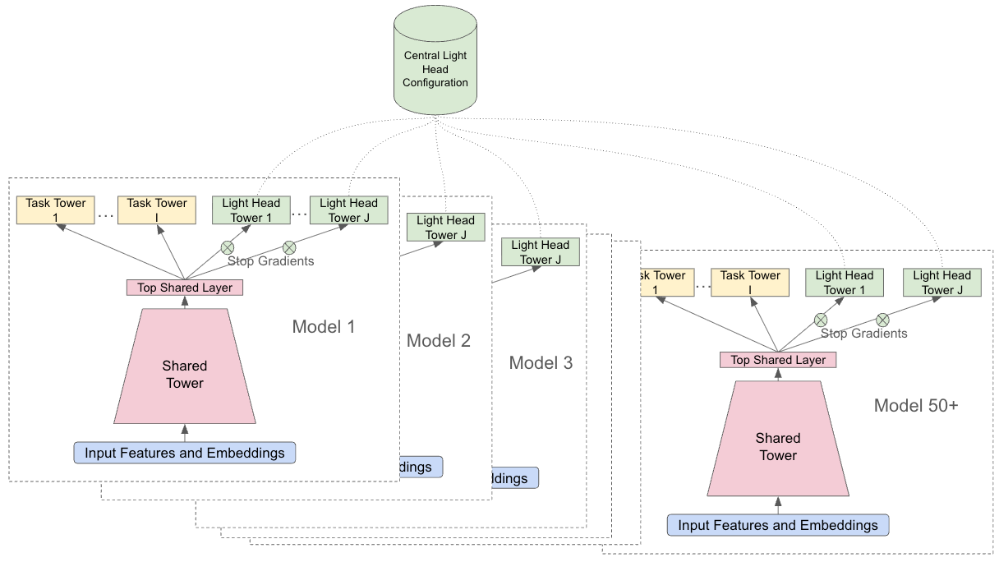
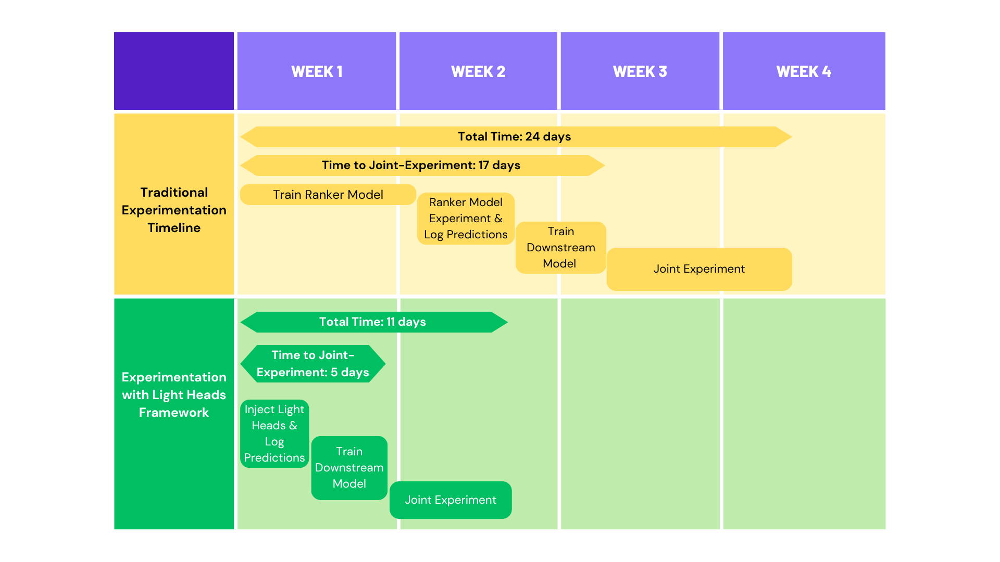

# YouTube: adding a new ranking task goes from code change to config change, validation cycle cut from 24 days to 11

> [中文版](google-light-heads.md)

### Paper: Lightweight Ranking Heads: Accelerating Multi-Task Experimentation in Production Recommender Systems
### Link: https://arxiv.org/abs/2609.25433
### Company: Google (YouTube)
### Idea: config-driven coordination across many models
### Area: ml-infra

## Overview:

This paper is about **how to shorten the validation cycle for a new task**. The approach is to **attach a shallow tower to the ranking model that does not backpropagate gradients and is not saved in checkpoints**. The main model is completely unaware of it, so a new task can be validated without waiting for the backbone to be retrained from scratch. But a shallow tower alone isn't enough. What really makes it safe for production is two other things: task definitions are moved out into a centralized config, so dozens of downstream models catch up in one go without changing code one by one; and a set of missing-value fallbacks, export gates and monitoring dashboards ensures that if one head breaks, it doesn't affect production. In the end the cycle shrinks from 24 days to 11.

Below: first the background, then the work in three areas.

## Background: why adding a new task takes months

Suppose you want to add a new prediction target to the ranking stage. It sounds like just adding a head, but in practice it gets stuck on problems at two levels.

**On the single-model side**: the new head's gradients flow back into the shared layers, so the main model has to be retrained from scratch, and with billions of parameters one run takes days to weeks; the shared layers get pulled by the new objective, and existing tasks lose metrics, i.e. negative transfer.

**On the model-fleet side**: the upstream model now outputs one more prediction, and the dozens of downstream models that consume this score no longer match the interface, so each has to be changed and retrained in turn. During the catch-up period some models have the new task and some don't, and this fragmented state can drag on for months, during which nobody dares to launch.

So the real cost was never the few days of training; it's the queue across the whole chain.

## 1 Shallow tower: the main model is unaware of the new task

**Structurally it's just a shallow tower**: a few hidden layers, attached at the same layer as the main heads, taking the same shared representation as input.

**A stop-gradient at the bottom** is the crux of the whole design. Backpropagation only updates the shallow tower's own hidden layers and does not touch the shared layers at all. The main model is completely unaware of this new head, so there is no retraining from scratch, no negative transfer, and existing task metrics are unaffected.

**No checkpoint; reinitialized on every training run**. Sounds counterintuitive, but what it saves is state management: no versions to manage, no compatibility to worry about, and removing it means it's simply gone. The cost is a metric dip at the start of each training run that recovers within a few steps; a shallow tower converges within a single run anyway.

## 2 Centralized config: dozens of models catch up at once

The three points above address the cost for a single model, but the problem of "dozens of downstream models have to catch up" remains. The solution is to pull task definitions into a centralized config: labels, loss functions, activation functions and evaluation metrics are all externalized and decoupled from model code, so the same new task can be injected into all models currently running experiments in one go, without changing code one by one.

The figure shows it clearly: each model is "shared tower → top shared layer → task towers (yellow) + shallow tower (green)", with Stop Gradients marked where the shallow tower attaches; the centralized config at the top connects via dashed lines to the shallow towers of 50+ models at once.

## 3 Engineering safeguards: making it safe to attach to the main model

Dynamic injection will always go wrong somewhere in production: the config hasn't propagated yet, a model's slot is stale, or a model never got this head attached at all. The paper provides a three-piece set:

**Missing-value fallback on the serving side**. The framework lets you define a default value for each Light Head; when the head can't be fetched online, the default fills in, so the whole request doesn't fail.

**Automatic quality gate before export**. Before a model is exported for launch, automatic evaluation runs, and every externally served head, including Light Heads, must pass a threshold to be released.

**Monitoring dashboard**. It aggregates Light Head quality across all serving models and picks out outlier heads before ramping to production.

There is also an easily overlooked design choice: **the config is read once at the start of training and frozen for the whole run**. So even if the centralized config changes, running jobs don't change midway, and it's also safe for stale models that haven't pulled the latest config yet.

## Results

**Cycle time**: joint experiment launch time drops from 17 days to 5, and the whole experiment cycle drops from 24 days to 11.

**A bonus gain along the way**: one light head was built specifically for paying users. On YouTube you can subscribe to third-party channels to watch series, movies and live sports; this head only serves users who already pay, and it raised their engagement with this kind of content by **+13.83%**. A targeted experiment serving only a small slice of users would never have gotten a slot under the old schedule; only after the cycle was shortened did it get a chance to be validated.

## Takeaways:
* The real contribution of this paper is treating "how experiments are organized" as something to optimize, rather than tuning yet another model version. For most teams the iteration bottleneck really isn't training, it's waiting for upstream and downstream to align, and what solves that half is the centralized config, not the shallow tower. With only the shallow tower and no externalized config, you still only save time for a single model.
* Stop-gradient plus no persistence amounts to fitting the main model with a "read-only probe". This pattern doesn't depend on YouTube's scale; any ranking system with a shared backbone and multiple tasks can copy it.
* At heart this is the backend config center moved onto model training: adding a new task goes from "change code + release" to "change config + push", and the accompanying fallbacks, gates and monitoring map one to one.

## Caveats

## Credibility: production (YouTube Home and Watch Next ranking stage, deployed online)

## Recommendation: practically useful
