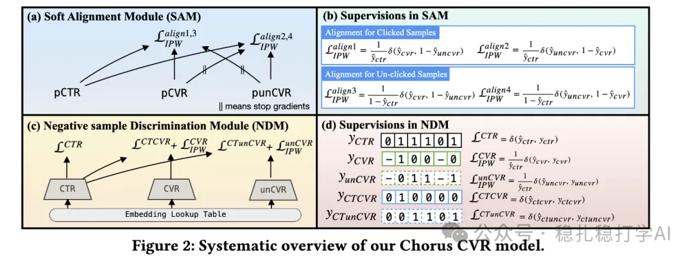

# Recommendation algorithm papers

> [中文版](2025-02-13-kuaishou-choruscvr.md)

1 ChorusCVR: Chorus Supervision for Entire Space Post-Click Conversion Rate Modeling

Link: https://arxiv.org/pdf/2502.08277

Company: Kuaishou

Area: CVR + debias

Overview: In CVR modeling, the training sample space and the inference space don't match, which hurts model quality. This work improves the model by aligning the sample space with the inference space. Specifically, ChorusCVR is a post-click CVR modeling method that introduces a chorus supervision to align the sample space and the inference space.

Taking the entire-space view, it improves model performance by aligning the sample spaces of CTR and CVR.

Credibility: offline

Recommendation: worth a look if you have time

Figure 2: Systematic overview of our Chorus CVR model.
