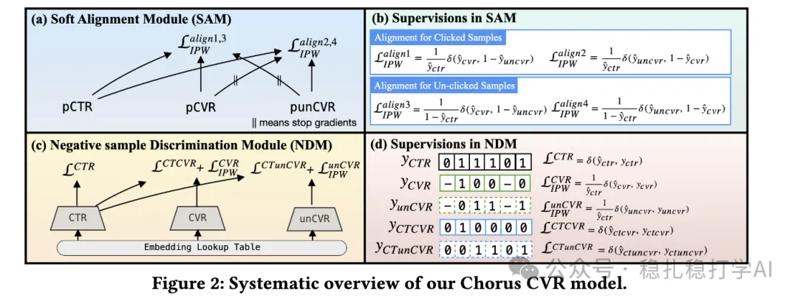

# 推荐算法paper

> 原文：https://mp.weixin.qq.com/s?__biz=MzkzNDYyNjM1NA==&mid=2247484130&idx=1&sn=2910ddd3654355594f08011a69c6ab69&scene=21#wechat_redirect
> 作者：算法工程师刘明星（稳扎稳打学AI）| 发表于 2025-02-13

关注我，每天为你精挑细选最优质、最新鲜的推荐算法paper，陪你一起保持进步、不断精进！

[本公众号paper推荐原则](https://mp.weixin.qq.com/s?__biz=MzkzNDYyNjM1NA==&mid=2247484097&idx=1&sn=18322c279290b555eb030e12953b7c7f&scene=21#wechat_redirect)

1 ChorusCVR: Chorus Supervision for Entire Space Post-Click Conversion Rate Modeling

网址：https://arxiv.org/pdf/2502.08277

公司：快手

方向：cvr+debias

解读：CVR建模的时候，样本空间和推理空间不一致，导致模型效果不佳。这个工作，是通过对齐样本空间和推理空间，来提升模型效果。具体地说，本文的ChorusCVR是一个post-click CVR建模方法，通过引入一个chorus监督，来对齐样本空间和推理空间。

从整个空间（entire space）的角度出发，通过对齐CTR和CVR的样本空间，来提升模型性能 。

可信度：离线

推荐等级：有时间看看

Figure 2: Systematic overview of our Chorus CVR model.

请帮忙点赞、转发，谢谢。您认为哪篇论文最有潜力应用到实际业务中？

推荐您继续阅读：

■ [推荐算法：字节两篇工业风的最新研究成果，助你领先一步！](https://mp.weixin.qq.com/s?__biz=MzkzNDYyNjM1NA==&mid=2247484124&idx=1&sn=37480104e408fda8067195db0e0213cb&scene=21#wechat_redirect)

■ [推荐算法月报：华为、阿里、快手等大厂最新研究成果，助你领先一步！](https://mp.weixin.qq.com/s?__biz=MzkzNDYyNjM1NA==&mid=2247484117&idx=1&sn=ca71dfe08c98de743fccfecd6f64d359&scene=21#wechat_redirect)

■ [推荐算法周报：华为、阿里、快手等大厂最新研究成果，助你领先一步！](https://mp.weixin.qq.com/s?__biz=MzkzNDYyNjM1NA==&mid=2247484101&idx=1&sn=263a7fe3199bc03b3f7baa811f8e298d&scene=21#wechat_redirect)

个人观点，仅供参考
