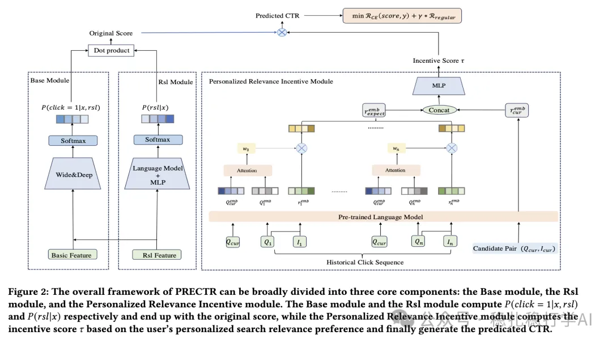

# Recommendation algorithms (2025.3.25): Alibaba decomposes user intent in search ranking

> [中文版](2025-03-25-ali-prectr.md)

1 PRECTR: A Synergistic Framework for Integrating Personalized Search Relevance Matching and CTR Prediction

Link: https://arxiv.org/pdf/2503.18395

Company: Alibaba

Area: search ranking

Overview: The two main tasks in a search ranking system are search relevance matching and click-through rate (CTR) prediction. This paper proposes a unified model that fuses personalized search relevance matching with CTR prediction (PRECTR).

Specifically, it has two main parts, CTR modeling and relevance modeling, with innovations in both.

(1) CTR modeling:

p(click=1|x) is decomposed into conditional probabilities under four cases: irrelevant, weakly relevant, relevant and strongly relevant. If rsl denotes one of the four cases, it becomes summation p(click=1|rsl,x)*p(rsl|x), where x is the input made of all features.

See it? Look familiar? This is one instance of the decoupling idea. Once again used, and once again shown to work? Here the benefit is that it can detect how a user balances relevance against direct preference for the item. In plain words: users behave differently across these four levels of similarity between the item and the query text, and this models that explicitly.

Guided by this idea, the neural network for p(click=1|x) can be split into "two towers" (the standard phrasing is two towers): one tower models the first term in the summation, the other models the second.

(2) Relevance modeling:

It does not simply model relevance between the query text and the item text.

It computes, from the user's historical behavior, a personalized expected-similarity score for the current query, i.e. this user's relevance expectation given the current query. You could give it another name, intention computation; the paper's title could carry the keyword intention-aware relevance. The computation uses the classic MHTA.

This expectation and the query-text/item-text relevance are fed into an MLP, which finally computes a "personalized" similarity score.

Other routine techniques such as pretraining get a fair amount of space in the paper, but readers don't need to dig into them.

Credibility: production

Recommendation: recommended

Figure 2: The overall framework of PRECTR can be broadly divided into three core components: the Base module, the Rsl module, and the Personalized Relevance Incentive module. The Base module and the Rsl module compute P(click = 1|x, rsl) and P(rsl|x) respectively and end up with the original score, while the Personalized Relevance Incentive module computes the incentive score r̂ based on the user's personalized search relevance preference and finally generate the predicted CTR.
