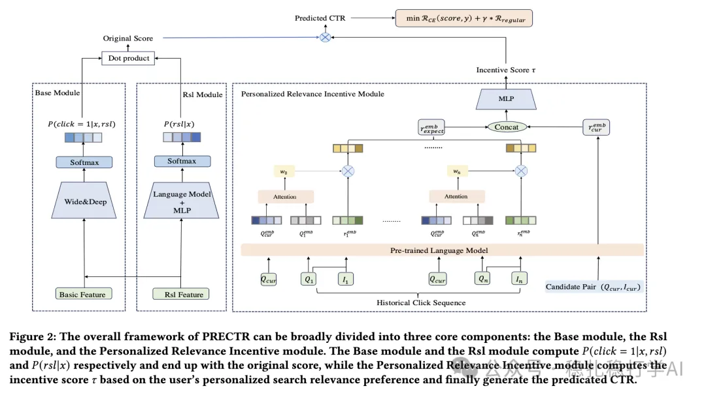

# 推荐算法(2025.3.25)：阿里在搜索推荐中的用户意图拆解

> 原文：https://mp.weixin.qq.com/s?__biz=MzkzNDYyNjM1NA==&mid=2247484354&idx=1&sn=11dfdfe34964fac5bad347458c0a1427&scene=21#wechat_redirect
> 作者：算法工程师刘明星（稳扎稳打学AI）| 发表于 2025-03-25

嘿，记得给“稳扎稳打学AI”添加星标

关注我，每天为你精挑细选最优质、最新鲜的推荐算法paper，陪你一起保持进步、不断精进！

> [English version](2025-03-25-ali-prectr.full.en.md)

📄 [本公众号paper推荐原则](https://mp.weixin.qq.com/s?__biz=MzkzNDYyNjM1NA==&mid=2247484097&idx=1&sn=18322c279290b555eb030e12953b7c7f&scene=21#wechat_redirect)

1 PRECTR: A Synergistic Framework for Integrating Personalized Search Relevance Matching and CTR Prediction

网址：https://arxiv.org/pdf/2503.18395

公司：阿里

方向：搜索推荐

解读：搜索推荐系统中的两个主要任务是搜索相关性匹配和点击率（CTR）预测 ，本文提出了一种提出了一种统一的个性化搜索相关性匹配和点击率预测融合模型（PRECTR）。

具体的，分成两大部分，包括CTR建模和相关性建模。在这两方面都有创新。

（1）CTR建模：

将p(click=1|x)拆解成不相关、弱相关、相关和强相关等4种情况下的条件概率，如果rls表示4种情况之一，那么就变成了summation p(click=1|rsl,x)*p(rsl|x),其中x是所有特征组成的input。

看到了吗？熟不熟悉，这就是解藕思想的一个体现。是不是又一次被使用、且被证明了？在这里，这样做的好处就是可以探测出来用户对相关性、用户对商品直接喜好的balance程度。说人话，就是商品与query text相似度在这4种不同情况下，用户的表现有所不同。这个给现性建模出来了。

在这种思路指导下，就可以将p(click=1|x)建模的神经网络拆解成“双塔”（标准说法是两个塔），一个塔建summation里的前者，一个塔建模summation里的后者。

（2）相关性建模：

不是简单建模query text与item文本的相关性。

根据用户的历史行为计算的，个性化的、针对当前query的用户期望相似分，即在给定当前查询的情况下的、该用户的相关性期望。可以给另外一个名字，叫意图（intention）计算，paper的名字里可以有keyword——intention-aware relevance。计算过程，使用经典的MH TA。

将这个期望和query text与item文本的相关性，送入到一个MLP，最终计算一个“个性化”的相似分。

其它预训练时常规手法，如遇训练，文章里用的笔墨篇幅不少，但是读者不必深究。

可信度：生产

推荐等级：推荐看

Figure 2: The overall framework of PRECTR can be broadly divided into three core components: the Base module, the Rsl module, and the Personalized Relevance Incentive module. The Base module and the Rsl module compute P(click = 1|x, rsl) and P(rsl|x) respectively and end up with the original score, while the Personalized Relevance Incentive module computes the incentive score r̂ based on the user's personalized search relevance preference and finally generate the predicted CTR.

请帮忙点赞、转发，谢谢。您认为哪篇论文最有潜力应用到实际业务中？

## 欢迎干货投稿 \ 论文宣传 \ 合作交流

推荐您继续阅读：

■ [LLM赋能推荐算法：谷歌、百度、快手、小红书的最新多模态实践](https://mp.weixin.qq.com/s?__biz=MzkzNDYyNjM1NA==&mid=2247484347&idx=1&sn=392a5f87dc9864e4c07683dc99dd2dcd&scene=21#wechat_redirect)

■ [推荐算法(2025.3.17)：阿里的Transformer特征交叉方法改进](https://mp.weixin.qq.com/s?__biz=MzkzNDYyNjM1NA==&mid=2247484331&idx=1&sn=0275ea88d3ae2df4b4c46a37c390ba01&scene=21#wechat_redirect)

■ [推荐算法周报(2025.3.14)：解藕与LLM是提升推荐效果的好方法](https://mp.weixin.qq.com/s?__biz=MzkzNDYyNjM1NA==&mid=2247484325&idx=1&sn=28ebac92b626e4681e9d43c1b51e99a2&scene=21#wechat_redirect)

历史文章索引：https://docs.qq.com/sheet/DYXZTZ0sseHRyZGtt?tab=BB08J2

由于公众号试行乱序推送，您可能不再准时收到稳扎稳打学AI的推送。为了第一时间收到本号的干货内容， 请将本号设为星标，以及常点文末右下角的“在看”。

喜欢的话点个在看吧👇

个人观点，仅供参考
