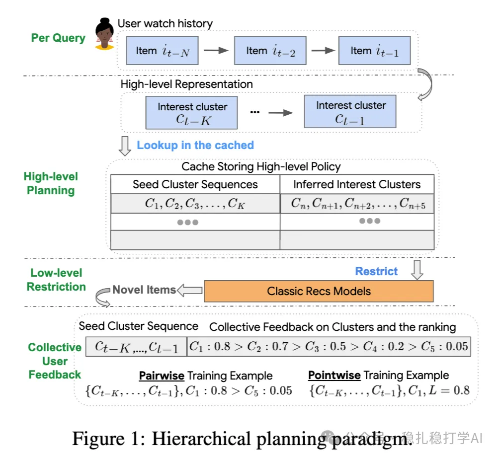

# Recommendation papers (2025.4.12): Google aligns models with user satisfaction using user feedback
> [中文版](2025-04-11-google-user-feedback-alignment.md)

> Source: WeChat post https://mp.weixin.qq.com/s?__biz=MzkzNDYyNjM1NA==&mid=2247484455&idx=1&sn=e3a5e18fad5984711098d3536b05d326&scene=21#wechat_redirect, published 2025-04-11.
> Split from the roundup "Recommendation papers (2025.4.12): look! A major work from Google"; same issue: [Google user feedback alignment for satisfaction](../multi-task-learning/2025-04-11-google-user-feedback-alignment.full.en.md), [Tencent BI-GNAS multi-task architecture search](../multi-task-learning/2025-04-11-tencent-bi-gnas-mtl.full.en.md), [Kuaishou EXUM watch-time uncertainty modeling](../loss-func/2025-04-11-kuaishou-watch-time-uncertainty.full.en.md), [Kuaishou unified generative search and recommendation](../generative-recommendation/2025-04-11-kuaishou-unified-search-rec.full.en.md).

User Feedback Alignment for User Satisfaction

Link: https://arxiv.org/pdf/2504.05522

Company: Google

Area: user feedback

Overview:

This paper mainly looks at how to use user feedback (likes, comments, feedback) to align the model with user satisfaction. The core idea is to adjust the model based on user feedback so that the recommender better matches user expectations.

The methods include:

(1) Explicit feedback handling: analyze users' explicit feedback (likes, comments, reports) and adjust model outputs to optimize user satisfaction.

(2) Implicit feedback modeling: infer user interest and satisfaction from behavior data (clicks, watch time, swipes) to further optimize the recommendation model.

(3) Feedback-satisfaction alignment: fine-tune the model with user feedback signals so that recommendations agree with user preferences and satisfaction goes up.

(4) Dynamic optimization: the model keeps updating on new feedback signals, keeping the recommender dynamically adaptive.

Takeaways: using user feedback to align the model with user satisfaction is a good idea.

Credibility: production

Recommendation: has practical value

