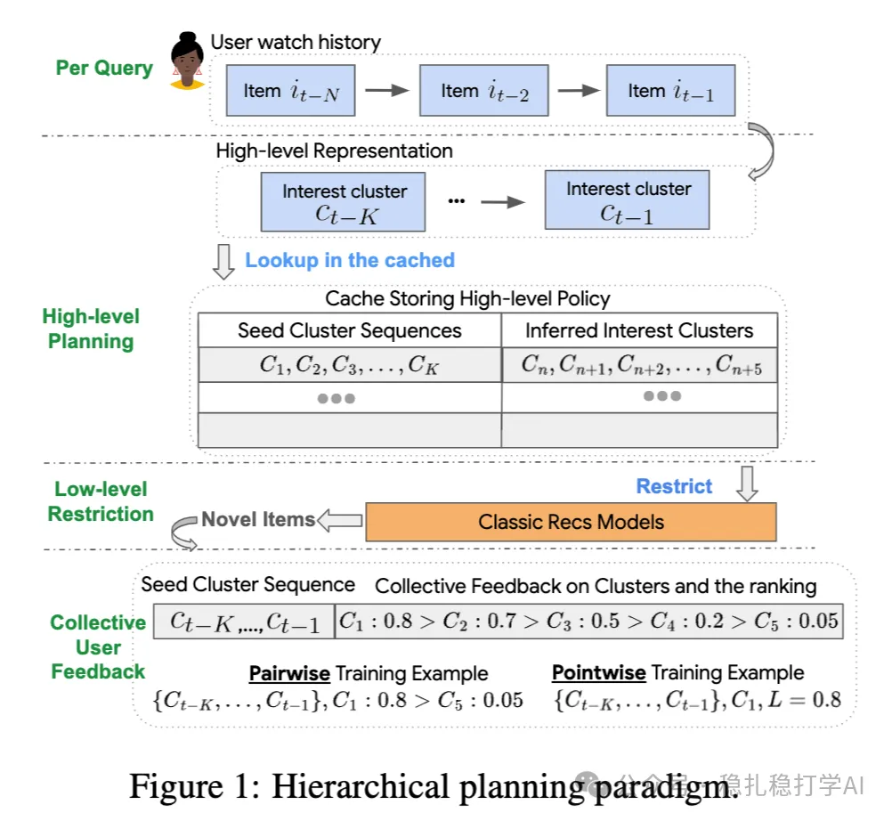

# 推荐算法(2025.4.12)：谷歌用用户反馈对齐用户满意度

> 原文：https://mp.weixin.qq.com/s?__biz=MzkzNDYyNjM1NA==&mid=2247484455&idx=1&sn=e3a5e18fad5984711098d3536b05d326&scene=21#wechat_redirect
> 作者：算法工程师刘明星（稳扎稳打学AI）| 发表于 2025-04-11
> 本文拆自《推荐算法(2025.4.12)：看！谷歌的大作》，同期 4 篇：[谷歌用户反馈对齐满意度](../multi-task-learning/2025-04-11-google-user-feedback-alignment.md)、[腾讯 BI-GNAS 多任务架构搜索](../multi-task-learning/2025-04-11-tencent-bi-gnas-mtl.md)、[快手 EXUM 时长预估不确定性建模](../loss-func/2025-04-11-kuaishou-watch-time-uncertainty.md)、[快手统一生成式搜推](../generative-recommendation/2025-04-11-kuaishou-unified-search-rec.md)。

关注我，每天为你精挑细选最优质、最新鲜的推荐算法paper，陪你一起保持进步、不断精进！

> [English version](2025-04-11-google-user-feedback-alignment.full.en.md)

User Feedback Alignment for User Satisfaction

网址：https://arxiv.org/pdf/2504.05522

公司：Google

方向：用户反馈

解读：

本文主要探讨了如何通过利用用户反馈（如点赞、评论、反馈）对齐模型与用户满意度之间的关系。核心思路是根据用户反馈对模型进行调整，使得推荐系统更符合用户的期望。

方法包括：

（1）显式用户反馈处理：通过分析用户的显式反馈（如点赞、评论、举报），调整模型输出，优化用户满意度。

（2）隐式反馈建模：通过用户行为数据（如点击、观看时长、滑动行为）推断用户的兴趣和满意度，进一步优化推荐模型。

（3）反馈与满意度对齐机制：利用用户反馈信号对模型进行微调，确保推荐结果与用户偏好一致，提升用户满意度。

（4）动态优化：模型不断根据新的反馈信号进行更新，保持推荐系统的动态适应性。

心得：利用用户反馈对齐模型和用户满意度，是一个很好的思路。

可信度：生产

推荐等级：有实践价值

