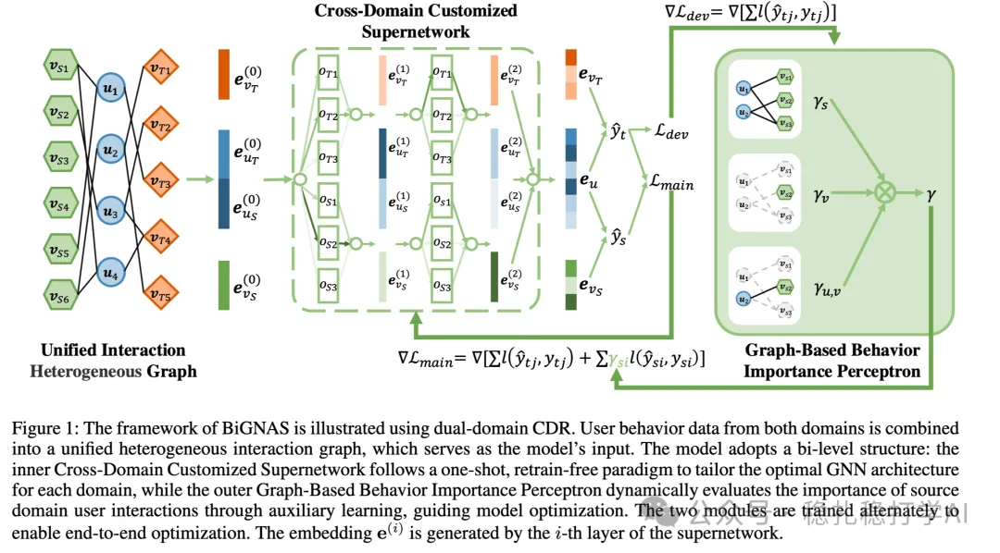

# Recommendation papers (2025.4.12): Tencent uses bidirectional guided neural architecture search for multi-task learning
> [中文版](2025-04-11-tencent-bi-gnas-mtl.md)

> Source: WeChat post https://mp.weixin.qq.com/s?__biz=MzkzNDYyNjM1NA==&mid=2247484455&idx=1&sn=e3a5e18fad5984711098d3536b05d326&scene=21#wechat_redirect, published 2025-04-11.
> Split from the roundup "Recommendation papers (2025.4.12): look! A major work from Google"; same issue: [Google user feedback alignment for satisfaction](../multi-task-learning/2025-04-11-google-user-feedback-alignment.full.en.md), [Tencent BI-GNAS multi-task architecture search](../multi-task-learning/2025-04-11-tencent-bi-gnas-mtl.full.en.md), [Kuaishou EXUM watch-time uncertainty modeling](../loss-func/2025-04-11-kuaishou-watch-time-uncertainty.full.en.md), [Kuaishou unified generative search and recommendation](../generative-recommendation/2025-04-11-kuaishou-unified-search-rec.full.en.md).

BI-GNAS: Bidirectional Guided Neural Architecture Search for Efficient Multi-Task Learning

Link: https://arxiv.org/pdf/2504.07102

Company: Tencent

Area: multi-task learning

Overview:

Tencent proposes Bidirectional Guided Neural Architecture Search (BI-GNAS), which handles architecture search in multi-task learning efficiently. The core idea is to build a bidirectional guidance mechanism between tasks, so the search can use both the similarities and the differences between tasks, which makes the search more efficient.

Specifically:

(1) Bidirectional guidance: guidance information is passed in both directions between every pair of tasks, so knowledge from different tasks reinforces each other and the model performs better in multi-task settings.

(2) Efficient architecture search: BI-GNAS introduces efficient search strategies such as weight sharing and a dynamically adjusted search space, which greatly speeds up the search. Compared with traditional NAS, BI-GNAS finds better architectures with fewer compute resources.

(3) Multi-task fusion: by fusing task-related architecture information into one unified search space, BI-GNAS finds architecture modules that can be shared across tasks, reducing parameter count while keeping the tasks independent.

Takeaways: neural architecture search (NAS) is a direction worth exploring in recommender systems.

Credibility: production (WeChat data, so treat it as production)

Recommendation: worth reading

