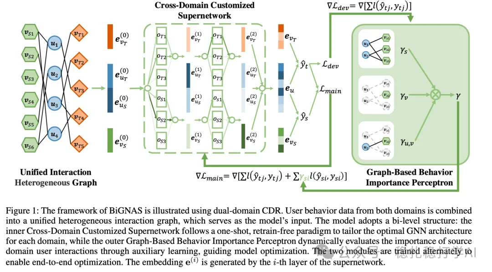

# 推荐算法(2025.4.12)：腾讯双向引导神经架构搜索做多任务学习

> 原文：https://mp.weixin.qq.com/s?__biz=MzkzNDYyNjM1NA==&mid=2247484455&idx=1&sn=e3a5e18fad5984711098d3536b05d326&scene=21#wechat_redirect
> 作者：算法工程师刘明星（稳扎稳打学AI）| 发表于 2025-04-11
> 本文拆自《推荐算法(2025.4.12)：看！谷歌的大作》，同期 4 篇：[谷歌用户反馈对齐满意度](../multi-task-learning/2025-04-11-google-user-feedback-alignment.md)、[腾讯 BI-GNAS 多任务架构搜索](../multi-task-learning/2025-04-11-tencent-bi-gnas-mtl.md)、[快手 EXUM 时长预估不确定性建模](../loss-func/2025-04-11-kuaishou-watch-time-uncertainty.md)、[快手统一生成式搜推](../generative-recommendation/2025-04-11-kuaishou-unified-search-rec.md)。

关注我，每天为你精挑细选最优质、最新鲜的推荐算法paper，陪你一起保持进步、不断精进！

> [English version](2025-04-11-tencent-bi-gnas-mtl.full.en.md)

BI-GNAS: Bidirectional Guided Neural Architecture Search for Efficient Multi-Task Learning

网址：https://arxiv.org/pdf/2504.07102

公司：腾讯

方向：多任务学习

解读：

腾讯提出了一种双向引导神经架构搜索（BI-GNAS）方法，能够高效地处理多任务学习中的架构搜索问题。核心思路是通过在任务之间建立双向引导机制，使得架构搜索过程可以同时利用任务的相似性和差异性，从而提高搜索效率。

具体的，

（1）双向引导机制：通过在每个任务之间建立双向的引导信息传递，使得任务之间的知识可以相互促进，提高模型在多任务场景中的表现。

（2）高效架构搜索：BI-GNAS通过引入高效的搜索策略，如权重共享和动态调整搜索空间，大幅提高了架构搜索的效率。相比于传统的NAS方法，BI-GNAS能够在较少的计算资源下找到更优的架构。

（3）多任务融合：通过将任务相关的架构信息融合到统一的搜索空间中，BI-GNAS能够在不同任务之间找到共享的架构模块，减少模型参数量，同时保持任务的独立性。

心得：神经架构搜索（NAS）在推荐系统中是一个值得探索的方向。

可信度：生产——微信数据，当作是生产了

推荐等级：推荐看看

