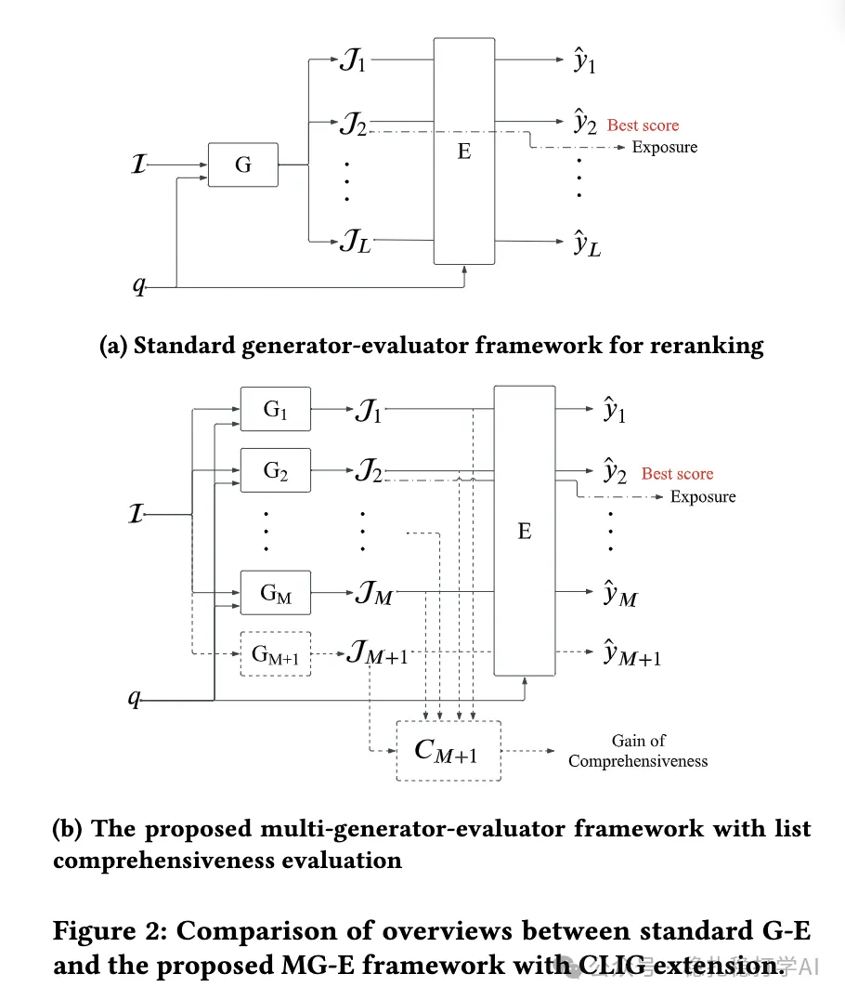

# Recommendation algorithms (2025.4.23): Kuaishou's novel use of ensemble learning in reranking

> [中文版](2025-04-23-kuaishou-ensemble-rerank.md)

1 List-wise Ensemble for Recommender Systems: Multi-Generator-Evaluator Framework with List Comprehensiveness Evaluation

Link: https://arxiv.org/pdf/2504.15429

Company: Kuaishou

Area: rerank

Overview: The paper proposes a multi-generator-evaluator. Multiple generators produce diverse candidate lists, and an evaluator selects the best list, forming a list-level ensemble model. To keep the generators from producing similar lists, it introduces a list comprehensiveness metric and a complementary list generation technique so the generators output more "different" lists, covering a wider range of recommendation possibilities and improving user experience.

The paper proposes a Multi-Generator-Evaluator framework: multiple generators produce diverse candidate lists, and an evaluator selects the best list, forming a list-level ensemble model.

Takeaways: This paper shows a novel application of ensemble learning in reranking, specifically a Selective Ensemble approach. It picks one or a few best results from the outputs of multiple models rather than fusing all outputs, usually selecting by a specific evaluation criterion.

Credibility: production

Recommendation: worth a look

