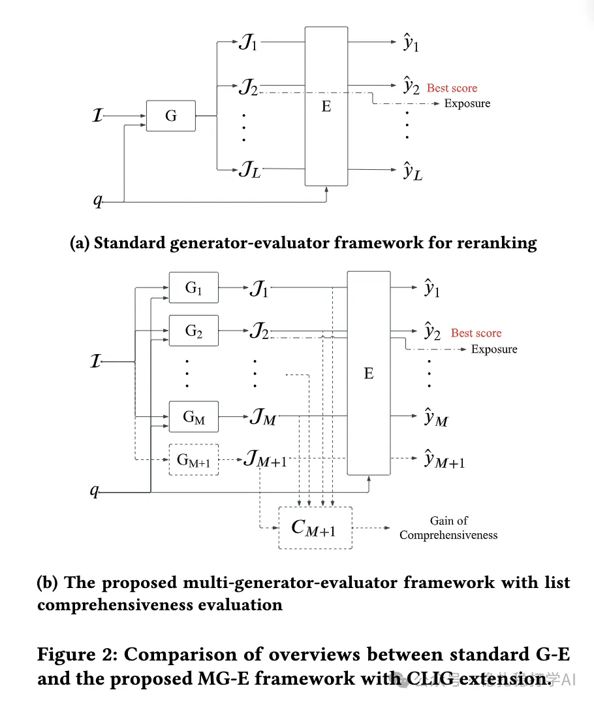

# 推荐算法(2025.4.23)：快手的集成学习在rerank的创新应用

> 原文：https://mp.weixin.qq.com/s?__biz=MzkzNDYyNjM1NA==&mid=2247484572&idx=1&sn=6fb64221bfafb2c814147dff5d6b7e34&scene=21#wechat_redirect
> 作者：算法工程师刘明星（稳扎稳打学AI）| 发表于 2025-04-23

嘿，记得给“稳扎稳打学AI”添加星标

关注我，每天为你精挑细选最优质、最新鲜的推荐算法paper，陪你一起保持进步、不断精进！

> [English version](2025-04-23-kuaishou-ensemble-rerank.full.en.md)

📄 [本公众号paper推荐原则](https://mp.weixin.qq.com/s?__biz=MzkzNDYyNjM1NA==&mid=2247484097&idx=1&sn=18322c279290b555eb030e12953b7c7f&scene=21#wechat_redirect)

1 List-wise Ensemble for Recommender Systems: Multi-Generator-Evaluator Framework with List Comprehensiveness Evaluation

网址：https://arxiv.org/pdf/2504.15429

公司：快手

方向：rerank

解读：论文提出了一种多生成器-评估器。通过多个生成器生成多样化的候选列表，结合评估器选择最优列表，形成列表级别的集成模型。其中，为了防止多个生成器生成相似列表，通过引入了列表全面性指标和互补列表生成技术 让生成器产出更“不同”的列表，以覆盖更广的推荐可能性，从而提升用户体验。

论文提出了一种多生成器-评估器（Multi-Generator-Evaluator）框架，通过多个生成器生成多样化的候选列表，结合评估器选择最优列表，形成列表级别的集成模型。

心得：这篇论文展示了集成学习在rerank的创新应用，具体采用了一种选择性集成（Selective Ensemble）方法。该方法从多个模型的输出中挑选一个或部分最佳结果，而非融合所有输出，通常基于特定的评估标准进行选择。

可信度：生产

推荐等级：推荐看看

请帮忙点赞、转发，谢谢。您认为哪篇论文最有潜力应用到实际业务中？

## 欢迎干货投稿 \ 论文宣传 \ 合作交流

推荐您继续阅读：

■ [推荐算法(2025.4.22)：Meta 将LLM应用于搜索有用性评估](https://mp.weixin.qq.com/s?__biz=MzkzNDYyNjM1NA==&mid=2247484565&idx=1&sn=068c6a26b1e752d855fcebd54c83288c&scene=21#wechat_redirect)

■ [推荐算法周报(2025.4.21)：有7篇大厂论文值得关注](https://mp.weixin.qq.com/s?__biz=MzkzNDYyNjM1NA==&mid=2247484559&idx=1&sn=c143dccb329dba0d3e214b1d3d4ee146&scene=21#wechat_redirect)

■ [推荐算法月报(2025.3)：行为序列和生成式的两大主题](https://mp.weixin.qq.com/s?__biz=MzkzNDYyNjM1NA==&mid=2247484550&idx=1&sn=ba23fdddd4d0c81b22f274cf27199918&scene=21#wechat_redirect)

历史文章索引：https://docs.qq.com/sheet/DYXZTZ0tseHRyZGtt?tab=BB08J2

由于公众号试行乱序推送，您可能不再准时收到稳扎稳打学AI的推送。为了第一时间收到本号的干货内容，请将本号设为星标，以及常点文末右下角的“在看”。

喜欢的话点个在看吧👇

个人观点，仅供参考
