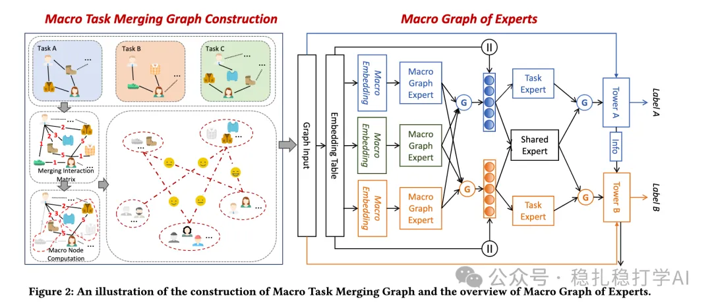

# Recommendation algorithms (2025.6.13): Alibaba's new MTL method works very well

> [中文版](2025-06-13-ali-mgoe.md)

1 Macro Graph of Experts for Billion-Scale Multi-Task Recommendation

Link: https://arxiv.org/pdf/2506.10520

Company: Alibaba

Area: MTL + graph

Overview:

This paper proposes a method called MGOE (Macro Graph of Experts) for multi-task prediction (e.g. click, add-to-cart) in billion-scale recommender systems. The core idea is to use a Macro Graph to simplify large-scale user-item interaction data into smaller groups (macro nodes), reducing compute while keeping the key information. The method:

Background and motivation:

Traditional multi-task recommendation models can't make effective use of micro-level user-item interaction relations (such as fine-grained connections in a graph structure), because graph computation at billion scale is too expensive. So the paper clusters micro nodes (users and items) into larger macro nodes and builds a macro graph (Macro Graph, MTMG), capturing macro interaction patterns and task correlations more efficiently. This both reduces computational complexity and brings global graph-structure information into the model, while keeping the key behavioral trends. The macro graph is then further processed by Macro Graph Experts (MGE) and macro prediction towers, so the model considers both micro features (user/item embeddings) and macro patterns (group behavior after clustering), improving recommendation performance.

Macro Task Merged Graph (MTMG):

On top of the macro graph, the paper further builds a Macro Task Merged Graph (MTMG). MTMG merges the nodes of multiple tasks into one graph, sharing information across tasks and making multi-task learning more efficient. MTMG is built as follows:

(1) User-item interactions: interactions between users and items are represented as a graph, with users and items as nodes and interactions as edges.

(2) Macro nodes: users and items are clustered into macro nodes, each representing a group of similar users or items.

(3) Macro graph: interactions between macro nodes are represented as a macro graph, with macro nodes as nodes and interactions between macro nodes as edges.

Macro Graph Experts (MGE):

On top of the macro graph, the paper further proposes Macro Graph Experts (MGE). MGE represents nodes of the macro graph as experts, sharing information across tasks and making multi-task learning more efficient. MGE is built as follows:

(1) Macro graph experts: nodes in the macro graph are represented as experts, each expert corresponding to one task.

(2) Expert sharing: the experts of multiple tasks share node information from the macro graph, so information is shared across tasks.

(3) Macro prediction towers: the outputs of the macro graph experts are fed into macro prediction towers to produce the final predictions.

The A/B results are good, so here they are: in online A/B tests in the ads scenario, compared with MMoE, MGOE raised PCTR by 2.16%, UCTR by 1.63%, CVR by 5.88%, GMV by 16.46%, and dwell time by 4.12%.

Takeaways: Existing information, such as from a GNN, can strengthen the optimization of other models. For behavior sequences, GNN embeddings can also be used directly to warm-start the embeddings of the sequence items.

Credibility: production

Recommendation: worth a look

