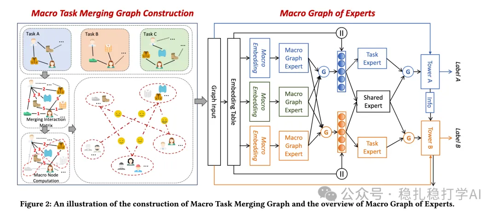

# 推荐算法(2025.6.13)：阿里的MTL新方法非常有效

> 原文：https://mp.weixin.qq.com/s?__biz=MzkzNDYyNjM1NA==&mid=2247484802&idx=1&sn=64699ffa093146caf0fa17ed1321c4f9&scene=21#wechat_redirect
> 作者：算法工程师刘明星（稳扎稳打学AI）| 发表于 2025-06-13

嘿，记得给“稳扎稳打学AI”添加星标

关注我，每天为你精挑细选最优质、最新鲜的推荐算法paper，陪你一起保持进步、不断精进！

> [English version](2025-06-13-ali-mgoe.full.en.md)

👆 [本公众号paper推荐原则](https://mp.weixin.qq.com/s?__biz=MzkzNDYyNjM1NA==&mid=2247484097&idx=1&sn=18322c279290b555eb030e12953b7c7f&scene=21#wechat_redirect)

1 Macro Graph of Experts for Billion-Scale Multi-Task Recommendation

网址：https://arxiv.org/pdf/2506.10520

公司：阿里

方向：MTL+graph

解读：

本文提出了一种叫 MGOE（Macro Graph of Experts） 的方法，解决亿级推荐系统多任务预测（如点击、加入购物车）的问题。核心思路是用 宏图（Macro Graph） 把大规模用户-物品交互数据简化成更小的群体（宏节点），降低计算量，同时保留关键信息。具体方法：

背景和动机：

传统的多任务推荐模型无法有效利用微观层面（micro-level）的用户-物品交互关系（如图结构中的细粒度连接），因为亿级规模的图计算成本太高。因此，论文提出通过将微观节点（用户和物品）聚类成更大的宏节点（macro nodes），构建一个宏图（Macro Graph，MTMG），从而以更高效的方式捕捉宏观交互模式和任务相关性。这样既降低了计算复杂性，又能在模型中融入图结构的全局信息，同时保留关键的行为趋势。这个宏图再通过宏图专家（MGE）和宏预测塔进一步处理，确保模型能同时考虑微观特征（用户/物品嵌入）和宏观模式（聚类后的群体行为），提升推荐性能。

宏任务合并图（MTMG）：

在宏图的基础上，论文进一步构建了宏任务合并图（MTMG）。MTMG将多个任务的节点合并为一个图，从而在多个任务之间共享信息，提升多任务学习的效率。MTMG的构建过程如下：

（1）用户-物品交互：用户和物品之间的交互被表示为一个图，图中节点是用户和物品，边是交互行为。

（2）宏节点：将用户和物品聚类成宏节点，每个宏节点代表一组相似的用户或物品。

（3）宏图：宏节点之间的交互被表示为一个宏图，图中节点是宏节点，边是宏节点之间的交互行为。

宏图专家（MGE）：

在宏图的基础上，论文进一步提出了宏图专家（MGE）。MGE通过将宏图中的节点表示为专家，从而在多个任务之间共享信息，提升多任务学习的效率。MGE的构建过程如下：

（1）宏图专家：将宏图中的节点表示为专家，每个专家对应一个任务。

（2）专家共享：多个任务的专家共享宏图中的节点信息，从而在多个任务之间共享信息。

（3）宏预测塔：将宏图专家的输出输入到宏预测塔中，从而生成最终的预测结果。

AB不错，贴一下：在广告场景的在线AB测试中，相较MMoE，MGOE的PCTR提升2.16%、UCTR提升1.63%、CVR提升5.88%、GMV提升16.46%、停留时间增加4.12%。

心得：已有信息，如GNN，可以加强其它模型的优化。在行为序列时候，GNN embedding也可以直接预热序列item的embed。

可信度：生产

推荐等级：推荐看看

请帮忙点赞、转发，谢谢。您认为哪篇论文最有潜力应用到实际业务中？

## 欢迎干货投稿 \ 论文宣传 \ 合作交流

推荐您继续阅读：

■ [推荐算法(2025.6.12)：Meta的生成式推荐方法](https://mp.weixin.qq.com/s?__biz=MzkzNDYyNjM1NA==&mid=2247484793&idx=1&sn=68ca1d3f310adf309060ac20f949daa4&scene=21#wechat_redirect)

■ [推荐算法(2025.6.11)：Google的意外推荐](https://mp.weixin.qq.com/s?__biz=MzkzNDYyNjM1NA==&mid=2247484786&idx=1&sn=1170e694c1f7a2c6759cebf02e0f4945&scene=21#wechat_redirect)

■ [推荐算法(2025.6.10)：Meta的离线召回新方法](https://mp.weixin.qq.com/s?__biz=MzkzNDYyNjM1NA==&mid=2247484780&idx=1&sn=04d946019642bef0239567c2a1af97e1&scene=21#wechat_redirect)

历史文章索引：https://docs.qq.com/sheet/DYXZTZ0tseHRyZGtt?tab=BB08J2

由于公众号试行乱序推送，您可能不再准时收到稳扎稳打学AI的推送。为了第一时间收到本号的干货内容， 请将本号设为星标，以及常点文末右下角的“在看”。

喜欢的话点个在看吧👇

个人观点，仅供参考
