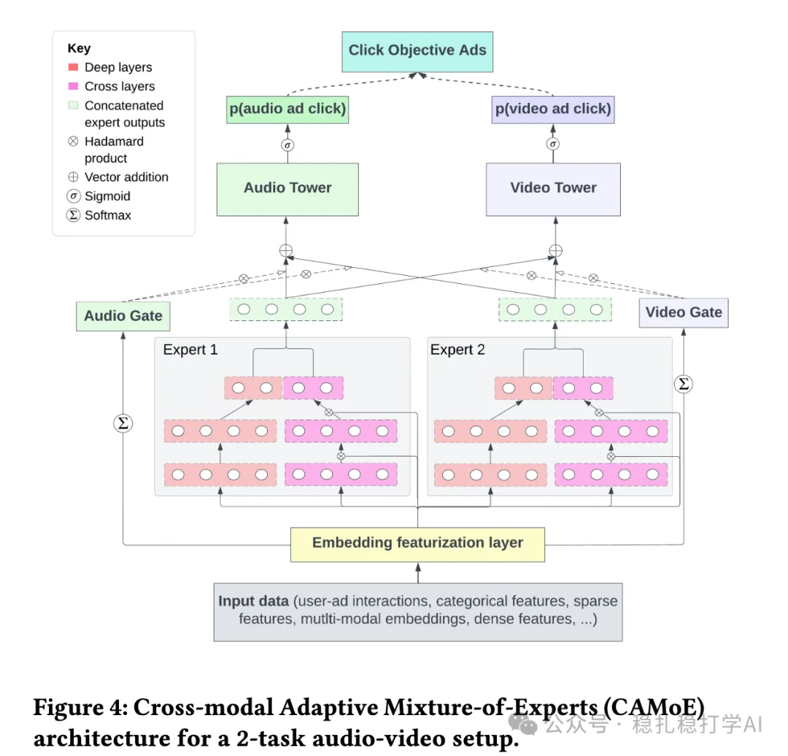

# Recommendation algorithms (2025.6.28): Spotify's mixed-content ranking works very well

> [中文版](2025-06-27-spotify-audio-centric-mtl.md)

1 An Audio-centric Multi-task Learning Framework for Streaming Ads Targeting on Spotify

Link: https://arxiv.org/pdf/2506.18735

Company: Spotify

Area: mixed-content ranking

Overview:

As everyone knows, Spotify is a mainly audio platform. In this scenario where audio and video ad items are ranked together (the former being the vast majority), the paper proposes a novel multi-task learning framework to optimize click-through rate (CTR) prediction on Spotify's ad platform and improve prediction quality. Specifically:

(1) Modality-aware task grouping: CTR prediction is split into two heads, audio and video, each handling the user behavior characteristics of its own modality.

(2) Adaptive Loss Masking (ALM): restricts each task's updates to samples of the same modality, easing the severe data imbalance caused by audio dominance.

(3) Deep & Cross Network (DCN) experts: DCN is integrated into a mixture-of-experts (MoE) architecture to capture complex feature interactions within each modality.

Possible sources of gain:

1. Since audio ads mostly play in the background, the model mines implicit interaction signals (such as clicks after background listening). This is label denoising work.

2. Splitting the CTR task into audio and video heads lets the audio head focus on scenarios such as Stream Audio and Podcast Audio, reducing interference from video data (though the interference isn't fully isolated). This lets the model model audio users' click behavior more precisely.

3. The balancing effect of adaptive loss masking eases data imbalance and keeps performance from being dragged down by sparse video data. Meanwhile, the audio task, with plenty of samples, benefits from more stable gradient updates.

4. Deep & Cross Network (DCN) integrated into the MoE architecture is especially suited to capturing multi-order user-ad feature interactions in audio ads (such as listening history, time of day, device state). From the comparisons, DCN is crucial; together with mining implicit interaction signals, these are the two most important pieces of work.

The A/B results: in tests across 20 regional markets, audio ad CTR rose 10% and video ad CTR rose 1.4%. After full deployment, audio ad CTR rose 14.5% and video ad CTR rose 1.3%, while expected cost per click (eCPC) for audio ad slots fell 4.8%.

Takeaways:

(1) For a specific scenario, mining the data, such as features and labels, may be the most effective thing.

(2) DCN is validated as effective by Spotify.

(3) Compared with the cutthroat competition at big Chinese tech companies, Spotify is still developing at a steady pace.

Credibility: production

Recommendation: worth a look

