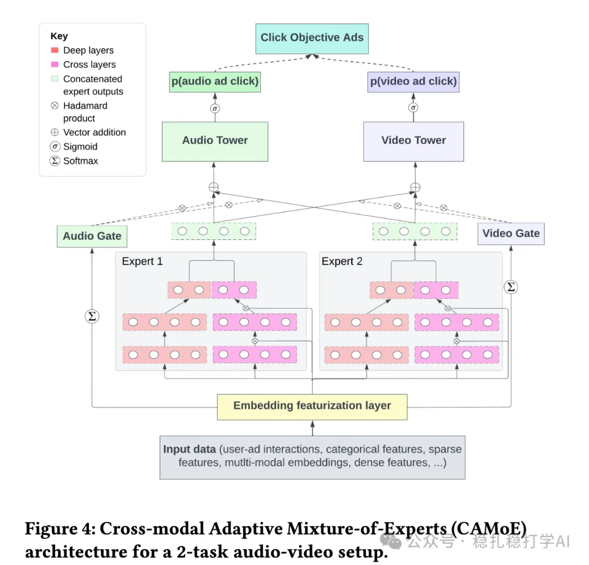

# 推荐算法(2025.6.28)：Spotify的混流排序非常有效

> 原文：https://mp.weixin.qq.com/s/aFjFSDYjhJs3gvu2RiclhA
> 作者：算法工程师刘明星（稳扎稳打学AI）| 发表于 2025-06-27

👆 [本公众号paper推荐原则](https://mp.weixin.qq.com/s?__biz=MzkzNDYyNjM1NA==&mid=2247484097&idx=1&sn=18322c279290b555eb030e12953b7c7f&scene=21#wechat_redirect)

1 An Audio-centric Multi-task Learning Framework for Streaming Ads Targeting on Spotify

网址：https://arxiv.org/pdf/2506.18735

公司：Spotify

方向：混流排序

解读：

众所周知，Spotify是一个以音频为主的平台。在该音频、视频广告item的混流（前者占绝大多数）场景中，论文提出了一种新颖的多任务学习框架，用于优化Spotify广告平台的点击率（CTR）预测，提升模型预测效果。具体包括：

（1）模态感知任务分组：将CTR预测任务分为音频和视频两个头，分别处理不同模态的用户行为特性。

（2）自适应损失掩码（ALM）：通过限制任务更新仅针对同模态样本，缓解音频模态主导的严重数据不平衡问题。

（3）深度交叉网络（DCN）专家：在混合专家（MoE）架构中集成DCN，捕获各模态内的复杂特征交互。

可能的收益来源：

1. 针对音频广告主要在后台播放，挖掘了模型对隐性交互信号（如背景聆听后的点击）。这是Label的祛燥工作。

2. 将CTR任务分为音频和视频两个head，音频head专注于Stream Audio、Podcast Audio等场景，减少了视频数据的干扰（尽管干扰未完全隔离）。这允许模型更精准地针对音频用户的点击行为建模。

3. 自适应损失掩码的平衡作用缓解了数据不平衡，避免被视频稀疏数据拉低性能。同时，音频任务因样本充足，受益于更稳定的梯度更新。

4. Deep & Cross Network (DCN) 集成在MoE架构中，特别适合捕获音频广告中用户-广告间的多阶特征交互（如听歌历史、时间段、设备状态）。通过对比，DCN至关重要，跟隐性交互信号的挖掘，是两个最重要的工作。

AB贴一下：在20个区域市场测试中，使音频广告 CTR 提高10%，视频广告提高1.4%。全面部署后，音频广告 CTR 提升14.5%，视频广告提升1.3%，同时音频广告位的预期每次点击成本（eCPC）降低4.8%。

心得：

（1）针对特定场景，挖掘数据，如特征、Label，可能是最有效的。

（2）DCN被Spotify验证有效。

（3）相比国内大厂卷成狗，Spotify还是在稳步发展中。

可信度：生产

推荐等级：推荐看看

请帮忙点赞、转发，谢谢。您认为哪篇论文最有潜力应用到实际业务中？

## 欢迎干货投稿 \ 论文宣传 \ 合作交流

推荐您继续阅读：

■ [推荐算法(2025.6.26)：京东的搜索多模态召回效果明显](https://mp.weixin.qq.com/s?__biz=MzkzNDYyNjM1NA==&mid=2247484837&idx=1&sn=28757fc2abea8591fe69fc471b5ef7ab&scene=21#wechat_redirect)

■ [推荐算法(2025.6.25)：eBay的搜索套娃表征学习简单有趣](https://mp.weixin.qq.com/s?__biz=MzkzNDYyNjM1NA==&mid=2247484831&idx=1&sn=6795d2f305b16b5cbcb18d5e58e8ea8b&scene=21#wechat_redirect)

■ [推荐算法(2025.6.24)：沃尔玛的LLM生成标题效果显著](https://mp.weixin.qq.com/s?__biz=MzkzNDYyNjM1NA==&mid=2247484825&idx=1&sn=2db234a57eac403b1865372b431dcaa0&scene=21#wechat_redirect)

历史文章索引：https://docs.qq.com/sheet/DYXZTZ0tseHRyZGtt?tab=BB08J2

由于公众号试行乱序推送，您可能不再准时收到稳扎稳打学AI的推送。为了第一时间收到本号的干货内容， 请将本号设为星标，以及常点文末右下角的“在看”。

喜欢的话点个在看吧👇

个人观点，仅供参考
