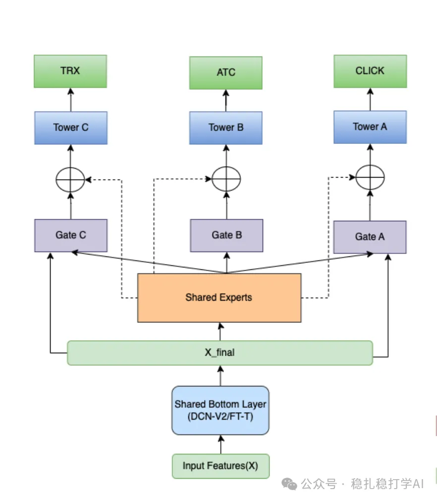

# Recommendation algorithms (2025.8.14): Walmart's MTL model covers architecture, features and samples

> [中文版](2025-08-14-walmart-mtl-search-ranking.md)

1 Personalized Product Search Ranking: A Multi-Task Learning Approach with Tabular and Non-Tabular Data

Link: https://arxiv.org/pdf/2508.09636

Company: Walmart

Area: search + multimodal + MTL

Overview:

(1) Features and feature crossing

1) A pretrained TinyBERT extracts embeddings for the query and the item text separately; the match score is concatenated with other features as model input.

2) A feature-crossing fusion layer.

Uses DCN-V2 or FT-Transformer.

MMoE is not an innovation.

(2) A new derived task: (query, item) relevance

On top of the existing 3 tasks, a label is pieced together and given its own task head.

The way it's pieced together is a method we use often: based on click positions, conversions, click frequency and semantic match across all (query, item) pairs, regardless of user, hand-craft a score. Convert it into multiple class labels (e.g. low/medium/high relevance; the bucketing doesn't specify the number of classes) to capture "nuanced" relevance levels. Then one-hot encode the labels and optimize as multi-class classification with a categorical cross-entropy loss.

(3) A new data sampling strategy

To address negative-sample bias and product category diversity, it designs a sampling method that buckets by category and bins by impression count, balancing positive/negative samples (controlled by hyperparameters α and β). This ensures the model captures the diverse behavior of popular and niche products, improving generalization.

Offline performance on private data is good: ~0.5-1.2% improvement.

Takeaways:

(1) Hand-crafting a label and setting up a task for it is a popular practice in industry.

(2) One way for multimodal signals to help the main model is to compute a comparison and feed the comparison result into the main model.

(3) A feature-crossing fusion base model that thoroughly crosses and fuses features before they enter the networks above is a popular practice.

Credibility: production

Recommendation: worth a look

