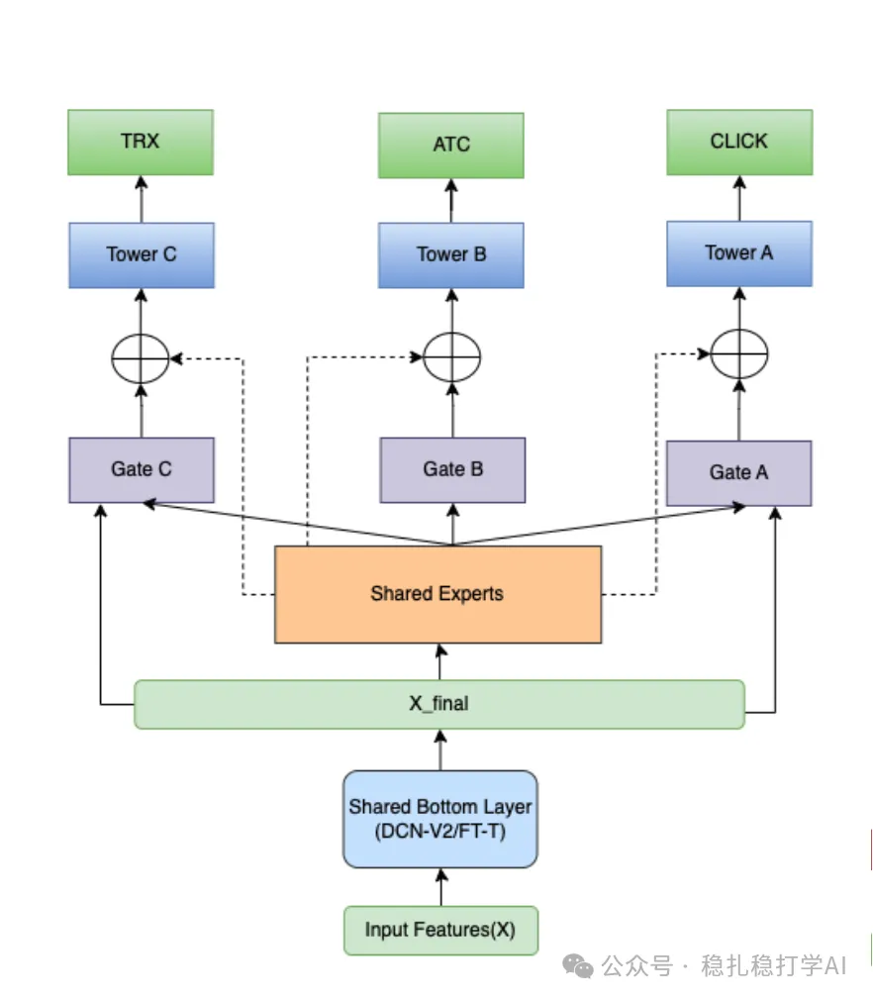

# 推荐算法(2025.8.14)：沃尔玛的MTL模型，架构/特征/样本的工作面面俱到

> 原文：https://mp.weixin.qq.com/s/65rzOhDJMvuTuWS7Xts9-g
> 作者：算法工程师刘明星（稳扎稳打学AI）| 发表于 2025-08-14

嘿，记得给“稳扎稳打学AI”添加星标

关注我，每天为你精挑细选最优质、最新鲜的推荐算法paper，陪你一起保持进步、不断精进！

👆 [本公众号paper推荐原则](https://mp.weixin.qq.com/s?__biz=MzkzNDYyNjM1NA==&mid=2247484097&idx=1&sn=18322c279290b555eb030e12953b7c7f&scene=21#wechat_redirect)

1 Personalized Product Search Ranking: A Multi-Task Learning Approach with Tabular and Non-Tabular Data

网址：https://arxiv.org/pdf/2508.09636

公司：沃尔玛

方向：搜索+多模态+MTL

解读：

（1）特征和特征交叉

1）用预训练的TinyBERT，分别提取（query，item文本）的embed，将match分，跟其它特征拼接作为模型输入。

2）特征交叉融合层。

用DCN-V2或FT-Transformer。

MMOE不是创新。

（2）衍生了一个新任务——（query，item）相关性

在已有3个任务的基础上，拼凑出了一个label，并为其指定了一个任务head。

拼凑方法是我们常用的方法，就是根据不区分用户的所有（query，item）对的点击位置、转化情况、点击频率和语义match情况，手搓一个分数。将其转换为多个类别标签（如低/中/高相关性，分桶方式未指定类别数），以捕捉“nuance”（细微的）相关性水平。然后，将标签one-hot编码，作为多类分类优化，使用categorical cross-entropy损失函数。

（3）新型数据采样策略

针对负样本偏差和产品类别多样性，设计按类别分桶、基于印象数分箱的采样方法，平衡正/负样本（超参数α、β控制）。这确保模型捕捉热门/冷门产品的多样行为，提高泛化能力。

在私有数据上，离线表现不错。提升~0.5-1.2%。

心得：

（1）手搓一个label，并设置相关的任务，是一个业界流行的做法。

（2）多模态助力主模型的一个做法，就是做对比，将对比结果加入到主模型。

（3）特征交叉融合基座模型，对特征做了充分交叉融合，再进入上方各个网络，是一个流行做法。

可信度：生产

推荐等级：推荐看看

请帮忙点赞、转发，谢谢。您认为哪篇论文最有潜力应用到实际业务中？

## 欢迎干货投稿 \ 论文宣传 \ 合作交流

推荐您继续阅读：

■ [推荐算法(2025.8.13)：Spotify的模型开发的好帮手](https://mp.weixin.qq.com/s/CDoMAyTyhUsUCHvNLaVJ2g)

■ [推荐算法(2025.8.12)：Meta的物料冷启动，特别特别简单](https://mp.weixin.qq.com/s/n-bNqOzMNCFITl6lTRm1fA)

历史文章索引：https://docs.qq.com/sheet/DYXZTZ0tseHRyZGtt?tab=BB08J2

请入微信群，群内我会给出更深入的解读，还可以共同讨论技术方案、发招聘广告、内推和交友等。

• 铁粉标准：关注一个月以上，且累计10次互动（评论、爱心、转发）、投稿1次。

• 入群方法：请您加个人微信lmxhappy，我拉您入群，请备注（只我个人看，不公开）。

由于公众号试行乱序推送，您可能不再准时收到稳扎稳打学AI的推送。为了第一时间收到本号的干货内容， 请将本号设为星标，以及常点文末右下角的“在看”。

喜欢的话点个在看吧👇

个人观点，仅供参考
