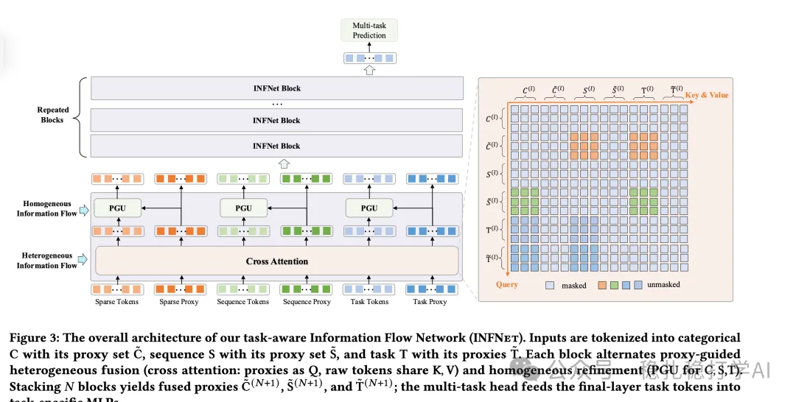

# Recommendation algorithms (2025.9.4): Kuaishou's new MTL method, and it works

> [中文版](2025-09-04-kuaishou-infnet-mtl.md)

1 INFNet: Enhanced Multi-Task Learning with Information Flow Network for E-commerce

Link: https://arxiv.org/pdf/2508.11565

Company: Kuaishou

Area: MTL

Overview: This paper proposes a new approach to MTL modeling. In multi-task learning, each task gets a learnable vector; INFNet layers cross it with other features (categorical, sequence, other tasks), multiple INFNet layers are stacked for higher-order crossing, and the resulting learnable vector then feeds a separate tower network for task prediction.

(1) Feature processing

Input features are split into 3 types: categorical features, sequence features and task features. Specifically: categorical features include user, item, context and similar features; sequence features include user behavior sequences and similar features; task features are each task's learnable vector.

(2) INFNet layer

An INFNet layer has two parts: heterogeneous information flow and homogeneous information flow. Specifically: heterogeneous information flow crosses features of different types, and homogeneous information flow crosses features of the same type.

(3) Heterogeneous information flow

Cross-attention is used for exchange across types. There are 3 feature types: categorical, sequence and task. So there are 3 corresponding flows: flow into categorical, flow into sequence, and flow into task. Taking flow into categorical as an example: put simply, the categorical Query (a sequence) does cross-attention separately with the sequence features (a sequence) and the task features (a sequence), the former as query and each of the latter two independently as key/value; this yields two sequences, both the same length as the categorical sequence, which are added element by element. The other flows work similarly.

(4) Homogeneous information flow

This applies within-type processing to each of the 3 feature types, similar to EPNet: proxy tokens generate gating vectors through an MLP, which modulate the original tokens per feature type (channel). That is, use the proxy tokens to compute an attention, then use it to filter the original tokens via a Hadamard product.

(5) Task prediction

The output of the INFNet layers is fed into separate tower networks for task prediction. Specifically: each task has its own tower network, whose input is the INFNet output and whose output is that task's prediction.

A/B: on Kuaishou, CTR +1.5% over the baseline.

Takeaways: (1) The idea of this paper is very simple and direct: use INFNet layers to cross features of different types. The benefit is that it improves multi-task learning without adding much compute. (2) Putting the task vector into a sequence and then doing attention lets it "absorb" information from other features, so that it ends up representing all the information for that task. This has been a very common practice over the past few years, e.g. inserting a special token into a sequence, running a transformer, and taking the output embedding at the special token as the compressed information of the whole sequence.

Credibility: production

Recommendation: practically useful

