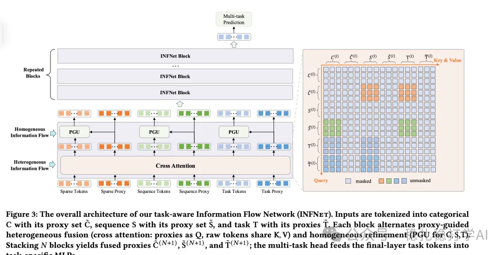

# 推荐算法(2025.9.4)：快手的MTL新方法，有效果

> 原文：https://mp.weixin.qq.com/s/y7uWpkrDDdlekri6P-xtQg
> 作者：算法工程师刘明星（稳扎稳打学AI）| 发表于 2025-09-04

嘿，记得给“稳扎稳打学AI”添加星标

关注我，每天为你精挑细选最优质、最新鲜的推荐算法paper，陪你一起保持进步、不断精进！

👆 [本公众号paper推荐原则](https://mp.weixin.qq.com/s/BhVGu0qH5kTz9N5zpsD3KA)

1 INFNet: Enhanced Multi-Task Learning with Information Flow Network for E-commerce

网址：https://arxiv.org/pdf/2508.11565

公司：快手

方向：MTL

解读：本文提出了一种MTL建模的新方法。即在多任务学习里，为每个任务设置可学习向量，通过INFNet层将其与其它特征（类别、序列、其它任务）做交叉，堆叠多层INFNet层实现高阶交叉，最终获得的可学习向量，后续接入独立的tower网络做任务预测。

（1）特征处理

将输入特征分成3类：类别特征、序列特征、任务特征。具体的：类别特征包括用户、物品、上下文等特征；序列特征包括用户行为序列等特征；任务特征包括每个任务的可学习向量。

（2）INFNet层

INFNet层由两个部分组成：异构信息流和同构信息流。具体的：异构信息流用于不同类型特征之间的交叉，同构信息流用于同类型特征之间的交叉。

（3）异构信息流

使用交叉注意力实现跨类型交换。有3种特征——类别、序列、任务等。那么就对应3种做法，包括流向类别、流向序列、流向任务。以流向类别为例，简单来说，就是用类别的Query（序列）分别跟序列特征（序列）、任务特征（序列）做cross-attention，前者是query，后两者独立分别是key/value；计算获得两个序列，序列长度都与类别序列相同，将两者一一相加。其它做法类似。

（4）同构信息流

就是对3类特征，分别做类内处理，就是类似epnet，代理token通过 MLP 生成门控向量，逐特征类别（通道）调制原始令牌。即用代理token，计算一个attention，再用它对原始token，hadamard积做filter。

（5）任务预测

将INFNet层的输出，输入到独立的tower网络中，做任务预测。具体的：每个任务都有一个独立的tower网络，输入是INFNet层的输出，输出是该任务的预测结果。

AB：在快手上，相比基线，CTR +1.5%。

心得：（1）本文的思路非常简单直接：用INFNet层，实现不同类型特征之间的交叉。这种方法的好处是：可以在不增加太多计算量的情况下，提升多任务学习的效果。（2）将任务向量放到序列里，再做attention，“吸收”其它特征的信息，最终将其代表该任务的所有信息。这个在过去几年是很常见的做法，比如在序列里插入一个特殊符号，做transformer，最终在输出中特殊符号对应的嵌入就是整个序列的压缩信息。

可信度：生产

推荐等级：有实践价值

请帮忙点赞、转发，谢谢。您认为哪篇论文最有潜力应用到实际业务中？

## 欢迎干货投稿 \ 论文宣传 \ 合作交流

推荐您继续阅读：

■ [推荐算法(2025.9.2)：eBay个性化广告推荐：让商品embedding学会理解用户意图](https://mp.weixin.qq.com/s?__biz=MzkzNDYyNjM1NA==&mid=2247485051&idx=1&sn=2824a1ac2e2669a23513d673cb6bc8b0&scene=21#wechat_redirect)

■ [推荐算法(2025.9.1)：Meta的底座+专家](https://mp.weixin.qq.com/s/h0vr5j0X4hBgDc8PXDohJg)

历史文章索引：https://docs.qq.com/sheet/DYXZTZ0tseHRyZGtt?tab=BB08J2

请入微信群，群内我会给出更深入的解读，还可以共同讨论技术方案、发招聘广告、内推和交友等。

• 铁粉标准：关注一个月以上，且累计10次互动（评论、爱心、转发）、或投稿1次。

• 入群方法：请您加个人微信lmxhappy，我拉您入群，请备注（只我个人看，不公开）。

喜欢的话点个在看吧👇

个人观点，仅供参考
