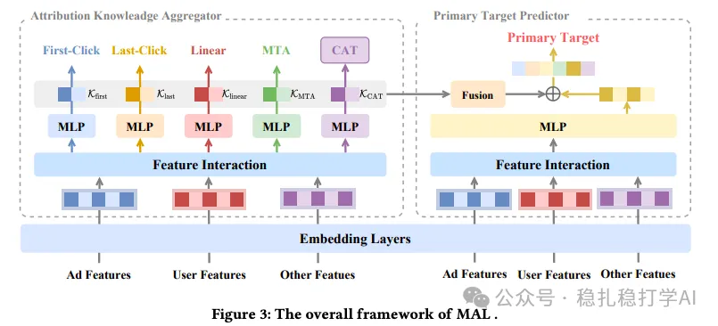

# Recommendation papers (2025.9.29): Alibaba's method for transferring knowledge from sub-tasks

> [中文版](2025-09-29-ali-mal-multi-attribution.md)

1 See Beyond a Single View: Multi-Attribution Learning Leads toBetter Conversion Rate Prediction

Link: https://arxiv.org/pdf/2508.15217

Company: Alibaba

Idea: multi-task (multiple attribution labels, knowledge transfer)

Area: CTR modeling

Overview:

This paper proposes a multi-attribution learning method that transfers knowledge from multiple sub-tasks to the main task. The transfer works by feeding the sub-tasks' intermediate output vectors into the main task.

Method:

(1) Multi-attribution sub-tasks

Define multiple attribution sub-tasks that capture different aspects of user behavior. Each sub-task corresponds to one attribution scheme, for example First-Click attribution, Last-Click attribution, Linear attribution, multi-touch attribution (MTA), and so on. Each sub-task is a binary classification task predicting whether the user converts under that attribution scheme.

(2) Knowledge aggregation

The intermediate output vectors of the sub-tasks are aggregated into the main task through an attention mechanism. Concretely: each sub-task's intermediate output vector goes into an attention network, which gives a weight per sub-task; then all sub-task intermediate vectors are summed with these weights into an aggregated vector; finally, the aggregated vector is fed into the main task.

(3) CAT (Cartesian-product attribution task)

A single attribution label is limited. Taking the Cartesian product of the N binary labels from the sub-tasks in (1) produces a 2^N-class multi-class classification task (in this paper N=4, giving 16 classes). This enriches the supervision signal and captures finer-grained behavior patterns.

A/B: on Alibaba ads, CVR +1.25% over the baseline.

Takeaways: (1) The idea is very simple and direct: use the knowledge of multiple sub-tasks to strengthen the main task. The benefit is that it can improve the main task without adding much compute. (2) The CAT task is also well worth borrowing. By combining the labels of multiple sub-tasks into a finer-grained classification task, it provides a richer supervision signal.

Caveats: transfer could be tried in every direction among the sub-tasks and the main task.

Credibility: production

Recommendation: practically useful

