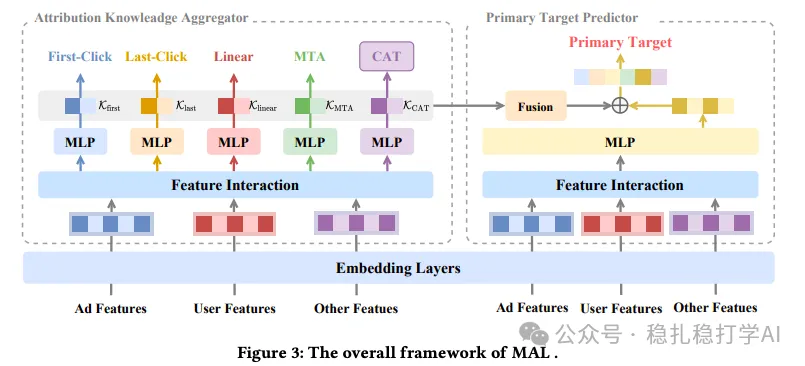

# 推荐算法(2025.9.29)：阿里的子任务的知识迁移方法

> 原文：https://mp.weixin.qq.com/s/rD39A0g6Y5bewV1ahWLMvA
> 作者：算法工程师刘明星（稳扎稳打学AI）| 发表于 2025-09-29（修改于2025年9月29日）

嘿，记得给“稳扎稳打学AI”添加星标

关注我，每天为你精挑细选最优质、最新鲜的推荐算法paper，陪你一起保持进步、不断精进！

👆 [本公众号paper推荐原则](https://mp.weixin.qq.com/s/BhVGu0qH5kTz9N5zpsD3KA)

1 See Beyond a Single View: Multi-Attribution Learning Leads toBetter Conversion Rate Prediction

网址：https://arxiv.org/pdf/2508.15217

公司：阿里

思想：多任务（多归因标签、知识迁移）

方向：CTR建模

解读：

本文提出了一种多归因学习方法，在主任务与多个子任务与之间，实现了后者对前者的知识迁移。迁移方法是将将子任务的中间输出向量，输入到主任务。

具体方法：

（1）多归因子任务

定义多个归因子任务，捕捉用户行为的不同方面。每个子任务对应一种归因方式，例如：首次点击归因（First-Click）、末次点击归因（Last-Click）、线性归因（Linear）、多触点归因（MTA）等。每个子任务都是一个二分类任务，预测用户是否会在该归因方式下发生转化。

（2）知识聚合

将多个子任务的中间输出向量，通过注意力机制，聚合到主任务中。具体的：将每个子任务的中间输出向量，输入到一个注意力网络中，得到每个子任务的权重；然后，将所有子任务的中间输出向量，加权求和，得到聚合后的向量；最后，将聚合后的向量，输入到主任务中。

（3）CAT（组合归因任务）

单一归因标签有限，通过笛卡尔积（Cartesian Product）组合（1）的多个子任务（N个）二元标签生成 2^N 类多类分类任务（本论文 N=4，生成 16 类）。丰富了监督信号，捕捉更细粒度的行为模式。

AB：在阿里广告上，相比基线，CVR +1.25%。

心得：（1）本文的思路非常简单直接：用多个子任务的知识，来增强主任务。这种方法的好处是：可以在不增加太多计算量的情况下，提升主任务的效果。（2）本文的CAT任务也非常值得借鉴。CAT任务通过组合多个子任务的标签，生成更细粒度的分类任务，从而提供更丰富的监督信号。

愚见：各个子任务、主任务之间都可以尝试互相迁移。可信度：生产

推荐等级：有实践价值

请帮忙点赞、转发，谢谢。

## 欢迎干货投稿 \ 论文宣传 \ 合作交流

推荐您继续阅读：

■ [推荐算法(2025.9.26)：阿里的生成式推荐语义ID的完整解决方案](https://mp.weixin.qq.com/s/-HBh2xhr55VfsNaTffI7VQ)

■ [推荐算法(2025.9.23)：阿里的双塔粗排，kmeans聚类，独立成塔](https://mp.weixin.qq.com/s/1HFAP1SyBpjDfqhLGXakkQ)

历史文章索引：https://docs.qq.com/sheet/DYXZTZ0tseHRyZGtt?tab=BB08J2

请入微信群，群内我会给出更深入的解读，还可以共同讨论技术方案、发招聘广告、内推和交友等。

• 铁粉标准：关注公众号一个月以上，且在公众号上累计15次互动（评论、爱心、转发）、或投稿1次。

• 入群方法：请您加个人微信lmxhappy，我拉您入群，请备注（只我个人看，不公开）。

喜欢的话点个在看吧👇

个人观点，仅供参考

修改于2025年9月29日
