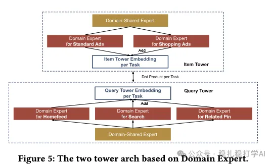
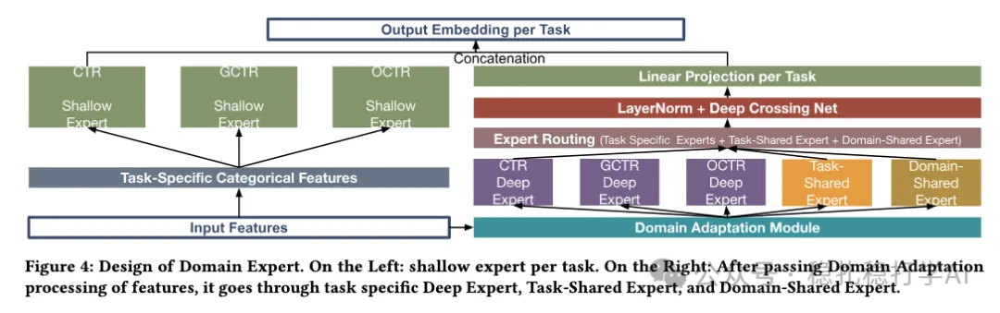

# Recommendation papers (2025.10.30): Pinterest's two-tower pre-ranking, CTR +2.41%

> [中文版](2025-10-30-pinterest-mtmd.md)

1 MTMD: A Multi-Task Multi-Domain Framework for Efficient Ranking in Large-Scale Recommendation Systems

Link: https://arxiv.org/pdf/2510.09857

Company: Pinterest

Idea: two-tower (alignment, distillation) + multi-domain (domain features, domain networks)

Area: pre-ranking + multi-domain + multi-task

Overview: The paper mainly uses a two-tower pre-ranking model to imitate the multi-task, multi-domain behavior of the ranking model. Pre-ranking sits after retrieval: the pre-ranking model scores candidates, takes the top-k, and sends them to the ranking stage for further ranking.

(1) Feature selection

Build an embedding table shared by the user tower and the item tower: task-agnostic features go into the embedding table, and task-specific features are concatenated directly onto the output of the user tower / item tower.

(2) Network structure

1) Network design

The user tower and the item tower each have 3 domain experts (homefeed, search, related pin), each domain expert being its own network. Add one domain-shared expert, for 7 networks in total. At the same time, each of the 3 domain experts uses a gate to control the output weights between itself and the domain-shared expert.

2) Training

Multi-task: for each task, the inner product of the matching user-tower and item-tower outputs is that task's prediction, which is KL-distilled against the ranking model's prediction.

Multi-domain: the losses of the domains are summed with weights.

(3) Inference

The user tower and the item tower each output one vector; the inner product of user and item is the score.

A/B: on Pinterest, CTR +2.41% over the two-tower baseline.

Takeaways: (1) The idea is very simple and direct: use a two-tower model to imitate the multi-task, multi-domain behavior of the ranking model. The benefit is that multi-task and multi-domain information is already taken into account at pre-ranking, improving pre-ranking quality.

Caveats: Figures 4 and 5 show two different networks, but both are called domain-shared expert. My guess is that the one in Figure 5 is redundant.

Credibility: production

Recommendation: practically useful

