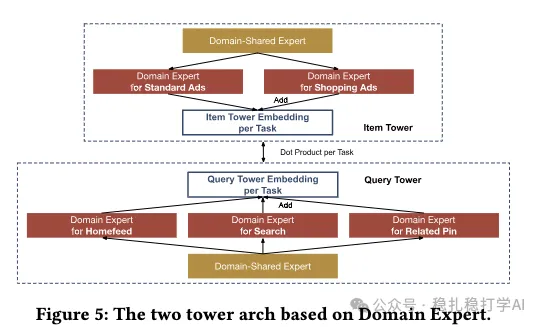
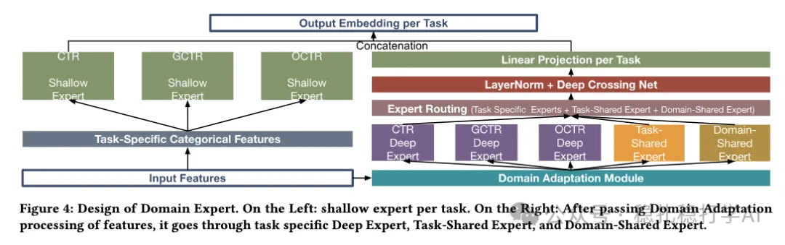

# 推荐算法(2025.10.30)：Pinterest双塔粗排，CTR+2.41%

> 原文：https://mp.weixin.qq.com/s/aCIGFrA506_HBn_Y59WT2g
> 作者：算法工程师刘明星（稳扎稳打学AI）| 发表于 2025-10-30（标题已修改；修改于2025年10月30日）

嘿，记得给“稳扎稳打学AI”添加星标

关注我，每天为你精挑细选最优质、最新鲜的推荐算法paper，陪你一起保持进步、不断精进！

> [English version](2025-10-30-pinterest-mtmd.full.en.md)

👆 [本公众号paper推荐原则](https://mp.weixin.qq.com/s/BhVGu0qH5kTz9N5zpsD3KA)

1 MTMD: A Multi-Task Multi-Domain Framework for Efficient Ranking in Large-Scale Recommendation Systems

网址：https://arxiv.org/pdf/2510.09857

公司：Pinterest

思想：双塔（对齐、蒸馏）+多域（域特征、域网络）

方向：粗排+多域+多任务

解读：本文主要是用双塔粗排模型来模拟精排模型的多任务、多域效果，粗排在召回后，用粗排模型打分，取topk，送给精排进一步排序。

（1）特征选择

做一个user塔和item塔的共享embedding表：任务无关特征进入embedding表，任务相关特征直接拼到user塔/item塔的输出。

（2）网络结构

1）网络设计

user塔、item塔各有3个domain expert（homefeed、search、related pin），每个domain expert都是一个网络。再加上一个domain-shared expert，共7个网络。于此同时，3个domain expert各用一个gate控制其与domain-shared expert的输出权重。

2）训练方法

多任务：user塔、item塔任务一对一做内积即为该任务的预测值，与精排的预测经过，做KL蒸馏。

多域：每个域的损失加权求和。

（3）推理

user塔、item塔各输出一个向量，用户和物品的内积即为打分。

AB：在Pinterest上，相比双塔基线，CTR +2.41%。

心得：（1）本文的思路非常简单直接：用双塔模型来模拟精排模型的多任务、多域效果。这种方法的好处是：可以在粗排阶段就考虑到多任务、多域的信息，从而提升粗排的效果。

愚见：图4、图5有两个不同的网络，但是名字都叫domain-shared expert。我推测图5里的，多余了。

可信度：生产

推荐等级：有实践价值

请帮忙点赞、转发，谢谢。

## 欢迎干货投稿 \ 论文宣传 \ 合作交流

推荐您继续阅读：

■ [推荐算法paper](https://mp.weixin.qq.com/s?__biz=MzkzNDYyNjM1NA==&mid=2247484024&idx=1&sn=b6c0bc04592d62da52ce1cfe36e84d1a&scene=21#wechat_redirect)

历史文章索引：https://docs.qq.com/sheet/DYXZTZ0tseHRyZGtt?tab=BB08J2

请入微信群，群内我会给出更深入的解读，还可以共同讨论技术方案、发招聘广告、内推和交友等。

• 铁粉标准：关注公众号一个月以上，且在公众号上累计15次互动（评论、爱心、转发）、或投稿1次，只欢迎技术同学。

• 入群方法：请您加个人微信lmxhappy，我拉您入群，请备注（只我个人看，不公开）。

喜欢的话点个在看吧👇

个人观点，仅供参考

修改于2025年10月30日
