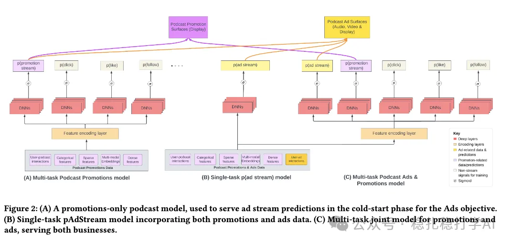

# Recommendation papers (2026.1.7): Spotify, MTL, cost down 22%, conversion up 18%

> [中文版](2026-01-06-spotify-mtl-podcast.md)

1 Cold-Starting Podcast Ads and Promotions with Multi-Task Learning on Spotify

Link: https://arxiv.org/pdf/2601.02306

Company: Spotify

Idea: transfer learning via data transfer

Area: MTL + cold start

Overview:

This paper proposes a multi-task model that merges ads and recommendation, used to predict promotion performance in cold-start settings with no historical data. The core idea is to model ads and recommendation, which have different data volumes and distributions, in one place, learning features shared across tasks with a single multi-task model, so as to make effective predictions in cold start.

Specifically,

(1) Model design

The paper proposes a multi-task model that treats ads and recommendation as two tasks sharing one bottom network. It includes:

1) Ad-based task: takes ad features (such as advertiser, ad type, ad content) as input and predicts metrics such as the ad's click rate and conversion rate.

2) Recommendation-based task: takes recommendation features (such as user history behavior, podcast content) as input and predicts metrics such as the recommendation's click rate and conversion rate.

By sharing the bottom network, the model can learn features shared between ads and recommendation, so in cold start the ad data can help the recommendation task learn.

(2) Handling the difference in data distribution

The data distributions of ads and recommendation differ; for example, ads have less data and recommendation has more. To address this, the paper proposes a data transfer method: first train a model on ad data, then transfer that model's weights to the recommendation task as its initialization. The recommendation task can then use the knowledge from ad data and do better in cold start.

(3) Handling the difference in data volume

The data volumes of ads and recommendation differ; for example, ads have less data and recommendation has more. To address this, the paper proposes a data augmentation method: augment the ad data to generate more training samples, balancing the data volume of ads and recommendation.

A/B: effective cost (eCPS) down by up to 22%, especially for low-streaming podcasts; stream conversion rate +18% overall and +24% for low-traffic podcasts.

Takeaways:

(1) The proposed multi-task model unifies ads and recommendation and, by sharing the bottom network, makes effective predictions in cold start. This is a good idea and worth borrowing.

(2) You can tell Spotify is not hyper-competitive; it probably doesn't have many engineers working on ads and recommendation algorithms.

Caveats:

(1) The paper is not written very fluently; the reading experience is poor and it took me quite a while.

Credibility: production

Recommendation: practically useful

Figure 2: (A) The promotions-only podcast model serves as the baseline for our comparisons. (B) A single-task pAdStream model is trained to predict only ad streams, while (C) the multi-task joint model predicts both ad streams and organic streams. In these models, the embedding layers are shared, while the deeper MLP layers are task-specific.
