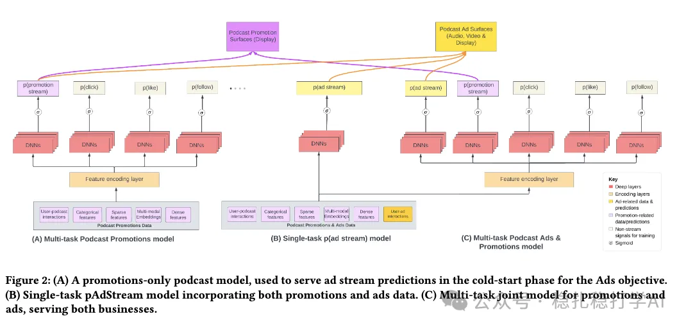

# 推荐算法(2026.1.7)：Spotify，MTL，降本+22%，转化率增效+18%

> 原文：https://mp.weixin.qq.com/s/Jp7lV9HpRmos4Jj0MNdarQ
> 作者：算法工程师刘明星（稳扎稳打学AI）| 发表于 2026-01-06（标题已修改；修改于2026年1月7日）

嘿，记得给“稳扎稳打学AI”添加星标

关注我，每天为你精挑细选最优质、最新鲜的推荐算法paper，陪你一起保持进步、不断精进！

> [English version](2026-01-06-spotify-mtl-podcast.full.en.md)

👆 [本公众号paper推荐原则](https://mp.weixin.qq.com/s/BhVGu0qH5kTz9N5zpsD3KA)

1 Cold-Starting Podcast Ads and Promotions with Multi-Task Learning on Spotify

网址：https://arxiv.org/pdf/2601.02306

公司：Spotify

思想：transfer learning之数据迁移

方向：MTL+冷启动

解读：

本文提出了一种将广告和推荐合并的多任务模型，用来在没有历史数据的冷启动场景下预测其推广效果。核心思想是将具有不同数据量和分布的广告和推荐统一建模，通过一个多任务模型来学习不同任务的共享特征，从而在冷启动场景下实现有效的预测。

具体来说，

（1）模型设计

本文提出了一种多任务模型，它将广告和推荐作为两个任务，共享一个底层网络。具体包括：

1）基于广告的任务：输入广告的特征（如广告主、广告类型、广告内容等），预测广告的点击率、转化率等指标。

2）基于推荐的任务：输入推荐的特征（如用户历史行为、播客内容等），预测推荐的点击率、转化率等指标。

通过共享底层网络，模型可以学习到广告和推荐之间的共享特征，从而在冷启动场景下，利用广告的数据来帮助推荐任务的学习。

（2）解决数据分布差异

广告和推荐的数据分布存在差异，例如广告的数据量较小，而推荐的数据量较大。为了解决这个问题，本文提出了一种数据迁移的方法：首先，在广告数据上训练一个模型，然后将该模型的权重迁移到推荐任务上，作为推荐任务的初始化。这样，推荐任务可以利用广告数据的知识，从而在冷启动场景下实现更好的效果。

（3）解决数据量差异

广告和推荐的数据量存在差异，例如广告的数据量较小，而推荐的数据量较大。为了解决这个问题，本文提出了一种数据增强的方法：通过对广告数据进行增强，生成更多的训练样本，从而平衡广告和推荐的数据量。

AB：有效成本（eCPS）降低高达22%，特别是对低流媒体播客；播放转化率，全部+18%，低流量播客+24%。

心得：

（1）本文提出的多任务模型，将广告和推荐统一建模，通过共享底层网络，实现了在冷启动场景下的有效预测。这是一个很好的思路，值得借鉴。

（2）看出来，spotify不卷哈，广告和推荐的算法的员工应该不多。

愚见：

（1）论文的行文不太流畅，阅读体验不太好，花了不少时间。

可信度：生产

推荐等级：有实践价值

Figure 2: (A) The promotions-only podcast model serves as the baseline for our comparisons. (B) A single-task pAdStream model is trained to predict only ad streams, while (C) the multi-task joint model predicts both ad streams and organic streams. In these models, the embedding layers are shared, while the deeper MLP layers are task-specific.

请帮忙点赞、转发，谢谢。

## 欢迎干货投稿 \ 论文宣传 \ 合作交流

推荐您继续阅读：

[推荐算法(2025.1.5)：腾讯，一站式推荐，观看时间+1.22%](https://mp.weixin.qq.com/s/fTek0UvLVEHcYuHMRszhiA)

[推荐算法(2025.12.23)：Pinterest，物料冷启动，互动10%](https://mp.weixin.qq.com/s/TEaQPAsJkMWsy0Yp8CeNAQ)

历史文章索引：https://docs.qq.com/sheet/DYXZTZ0tseHRyZGtt?tab=BB08J2

请入微信群，群内我会给出更深入的解读，还可以共同讨论技术方案、发招聘广告、内推和交友等。

• 铁粉标准：关注公众号一个月以上，且在公众号上累计15次互动（评论、爱心、转发）、或投稿1次，只欢迎技术同学。

• 入群方法：请您加个人微信lmxhappy，我拉您入群，请备注（只我个人看，不公开）。

喜欢的话点个在看吧👇

个人观点，仅供参考

修改于2026年1月7日
