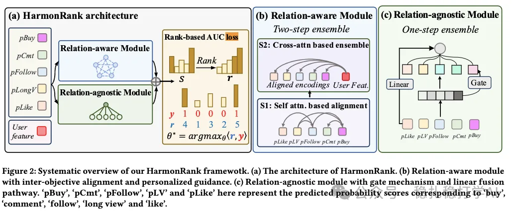

# Recommendation papers (2026.1.10): Kuaishou, MTL score fusion and a rebuilt ranking objective, purchases +2%

> [中文版](2026-01-10-kuaishou-harmonrank.md)

1 HarmonRank: Ranking-aligned Multi-objective Ensemble for Live-streaming E-commerce Recommendation

Link: https://arxiv.org/pdf/2601.02955

Company: Kuaishou

Idea: attention; reformulating AUC

Area: MTL score fusion + rebuilt ranking objective

Overview:

This paper proposes a new multi-objective ranking framework for optimizing the multi-objective ensemble.

Through inter-objective alignment and ranking alignment, it addresses two problems of traditional methods respectively:

(1) Ignoring inter-objective alignment: objectives partly depend on each other (e.g., purchase correlates with comment), but existing methods treat them as independent, leading to poor trade-offs.

(2) Inconsistency with the ranking task: these methods optimize with classification/regression losses, but final evaluation uses AUC, so the optimization direction doesn't match, leading to suboptimal performance.

Specifically,

(1) Inter-objective alignment

This means letting multiple objectives interact so as to fuse them into one fused score, used as the final basis for ranking. It is done with 3 scores produced by two modules.

Specifically, there are 2 modules:

1) Relation-aware module

The multiple predicted objective scores first go through self-attention, then cross-attention, producing one aggregated scalar score used as the final ranking basis.

* self-attention

The multiple predicted objective scores are discretized and passed through an embedding layer to get vectors, so each sample gets a sequence of score vectors.

With this sequence, just do one ordinary self-attention layer, giving a vector sequence of the same shape; details omitted.

* cross-attention

User features and context features are the query, and the self-attention output sequence is the key and value; do one cross-attention layer followed by a linear layer to get a scalar score.

Using user features as the query lets the model take the user's own traits into account (e.g., whether the user likes impulse buying, or likes to follow first and browse slowly), giving personalization.

2) Relation-agnostic module

The relation-agnostic module does 2 kinds of non-interacting fusion.

* One EPNet-like layer, giving one fused scalar score;

* One linear transformation layer, giving one fused scalar score.

The 3 scores from 1) and 2) are summed as the final ranking basis.

(2) Ranking alignment

AUC is modeled directly as the objective.

* Reformulating AUC

AUC is reformulated as a rank-sum of positive samples in an ordered list: G = (⟨r, y⟩ - constant) / (number of positive and negative samples), where r is the rank vector after sorting a batch by the scores from (1) (e.g., for sample scores s = [0.5, 0.3, 0.7], the rank vector is r = [2, 1, 3]).

* Continuous differentiation

The rank vector is non-convex and discontinuous, so it cannot directly be used for gradient optimization of the parameters. Differentiable sorting and regularization turn the non-convex sorting into a convex optimization problem (projection onto the permutahedron), enabling end-to-end gradient propagation.

Note that this loss can be described as "a multi-objective AUC maximization loss based on a differentiable rank sum". These two steps are not easy to understand and can't be explained clearly here in a sentence or two.

A/B: purchases +2.6%.

(Caption excerpt) …with inter-objective alignment and personalized guidance. (c) Relation-agnostic module with gate mechanism and linear fusion pathway. ‘buy’, ‘pCmt’, ‘pFollow’, and ‘pLV’ here represent the predicted probability scores corresponding to ‘buy’, ‘comment’, ‘follow’, ‘long view’ and ‘like’.

Takeaways:

(1) It breaks the long-standing awkward mismatch between the optimization metric and the evaluation metric in ranking. For a long time, AUC has been the monitoring metric while the loss has been a point-wise classification loss. This paper unifies both as AUC: the loss is an AUC loss. This applies not only to MTL score fusion but to single objectives too.

(2) The score fusion normally done in reranking is done at the same time in the ranking stage: alongside the ranking scores for the different objectives, it also outputs the fused ranking score.

Caveats:

The paper covers ranking alignment first and inter-objective alignment second. Explaining them the other way around would read better, because it matches the figure and makes the relationship between the two easier to understand.

Credibility: production

Recommendation: practically useful
