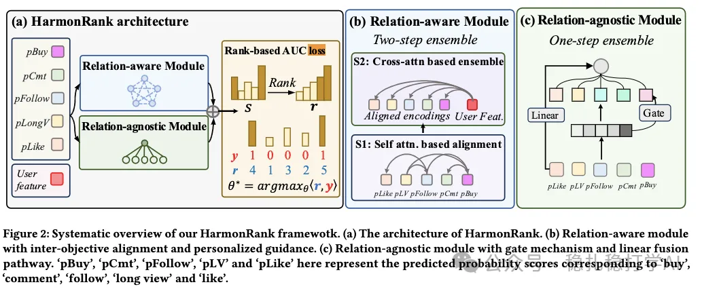

# 推荐算法(2026.1.10)：快手，MTL分数融合和排序目标重构，购买+2%

> 原文：https://mp.weixin.qq.com/s/X23x4Bsq40FnYLw7uxppxg
> 作者：算法工程师刘明星（稳扎稳打学AI）| 发表于 2026-01-10（修改于2026年1月10日）

嘿，记得给“稳扎稳打学AI”添加星标

关注我，每天为你精挑细选最优质、最新鲜的推荐算法paper，陪你一起保持进步、不断精进！

👆 [本公众号paper推荐原则](https://mp.weixin.qq.com/s/BhVGu0qH5kTz9N5zpsD3KA)

1 HarmonRank: Ranking-aligned Multi-objective Ensemble for Live-streaming E-commerce Recommendation

网址：https://arxiv.org/pdf/2601.02955

公司：快手

思想：attention思想；auc重构

方向：MTL分数融合+排序目标重构

解读：

本文提出了一种新的多目标排序的新框架，用于优化多目标集成。

通过目标间对齐和排序对齐，分别解决了传统方法的两个问题：

（1）忽略目标间对齐：目标间有部分依赖（如购买与评论的相关性），但现有方法视其为独立，导致权衡不佳。

（2）与排序任务不一致：这些方法用分类/回归损失优化，但最终评估用AUC，优化方向不匹配，导致子优性能。

具体的，

（1）目标间对齐

就是将多个目标做交互，从而融合获得一个融合分数，作为排序的最终依据。方法是通过两个模块获得的3个分数。

具体的，包括2个模块：

1）关系感知模块

将预测的多个目标分数值，先做self-attention，再做cross-attention，获得一个聚合分数scalar，作为最终排序依据。

* self-attention

预测的多个目标分数值，通过离散化，并通过embedding layer获得向量，从而每个样本获得了一个分数向量序列。

有了这个序列，就正常的做一层self-attention就行了，获得了同样shape的向量序列，细节不展开。

* cross-attention

用户特征和上下文特征作为query，self-attention的输出序列作为key和value，做一层cross-attention，再跟一层线性层，获得了一个scalar分数。

将用户特征作为query，可以结合用户自己的特点（比如用户是喜欢冲动下单，还是喜欢先关注再慢慢看） ，实现个性化。

2）关系无关模块

关系感知模块，做2种非交互的融合。

* 一层类似epnet的网络，获得一个融合scalar分数；

* 一层线性变换层，获得一个融合scalar分数。

1）和2）获得的3个分数加和作为最终的排序依据。

（2）排序对齐

直接以AUC作为建模目标。

* AUC重构

将AUC重构为有序列表中的正样本秩和问题：G = (⟨r, y⟩ - 常数) / (正负样本数)，其中r为一个batch根据（1）获得的分数，排序后的秩向量（例如样本分数s = [0.5, 0.3, 0.7]的秩向量r = [2, 1, 3]）。

* 连续微分

秩向量是非凸、非连续的，不能直接梯度优化参数。使用可微分排序技术和正则化，将非凸排序转为凸优化问题（Permutahedron投影），从而可以实现端到端梯度传播。

注意，这个损失可描述为“基于可微分秩和的多目标AUC最大化损失”。以上这两步不太好理解，在此也无法一两句讲清楚哈。

AB：购买+2.6%。

（图注节选）…with inter-objective alignment and personalized guidance. (c) Relation-agnostic module with gate mechanism and linear fusion pathway. ‘buy’, ‘pCmt’, ‘pFollow’, and ‘pLV’ here represent the predicted probability scores corresponding to ‘buy’, ‘comment’, ‘follow’, ‘long view’ and ‘like’.

心得：

（1）打破了排序长期的优化和评估的指标不一致的尴尬情况。长期以来，监控指标用AUC，但是loss是point-wise的分类loss。本文都统一为AUC，loss是AUC的loss。这个不光可以用到MTL分数融合上，单目标也是可以的。

（2）将rerank的做的分数融合的事情，在排序环节同时做到了，给出不同目标的排序分数的同时，也给出融合后的排序分数。

愚见：

论文先讲的排序对齐，再讲的目标间对齐，不如反过来讲解，更可读，因为与图更一致，也更容易理解两者的关系。

可信度：生产

推荐等级：有实践价值

请帮忙点赞、转发，谢谢。

## 欢迎干货投稿 \ 论文宣传 \ 合作交流

推荐您继续阅读：

[推荐算法(2026.1.7)：Spotify，MTL，降本+22%，转化率增效+18%](https://mp.weixin.qq.com/s/Jp7lV9HpRmos4Jj0MNdarQ)

[推荐算法(2026.1.5)：腾讯，一站式推荐，观看时间+1.22%](https://mp.weixin.qq.com/s/fTek0UvLVEHcYuHMRszhiA)

历史文章索引：https://docs.qq.com/sheet/DYXZTZ0tseHRyZGtt?tab=BB08J2

请入微信群，群内我会给出更深入的解读，还可以共同讨论技术方案、发招聘广告、内推和交友等。

• 铁粉标准：关注公众号一个月以上，且在公众号上累计15次互动（评论、爱心、转发）、或投稿1次，只欢迎技术同学。

• 入群方法：请您加个人微信lmxhappy，我拉您入群，请备注（只我个人看，不公开）。

喜欢的话点个在看吧👇

个人观点，仅供参考

修改于2026年1月10日
