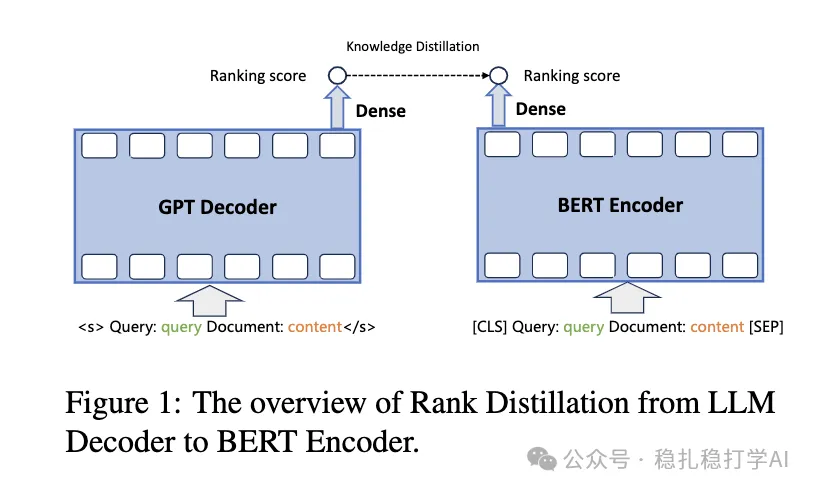
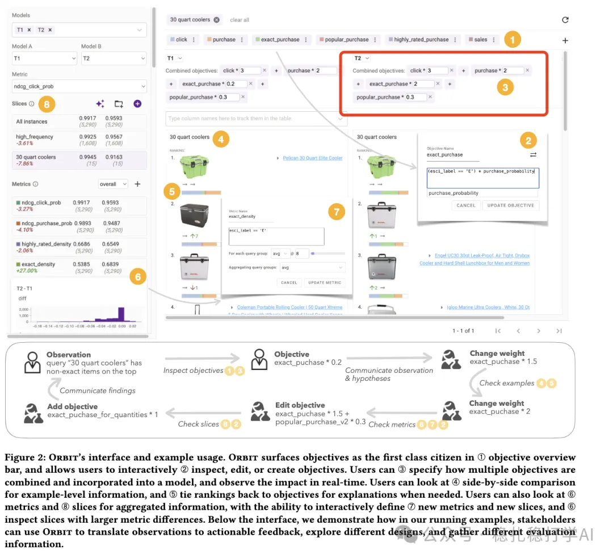

# Recommendation paper list (2024.11.08)

> [中文版](2024-11-08-three-papers.md)

> Source: WeChat post https://mp.weixin.qq.com/s/eHJwI0FUgcGpofOFvfiSDA, published 2024-11-07.

1. Best Practices for Distilling Large Language Models into BERT for Web Search Ranking

(1) Link: https://arxiv.org/pdf/2411.04539

(2) Company: Tencent

(3) Direction: search + LLM + transfer learning.

(4) Summary: uses transfer learning to move LLM capability into small BERT-family models, so they can be used in constrained environments.

(5) Takeaway: LLMs play a supporting, boosting role in a lot of work. Think about whether your own work could use them. This paper is simple; take a quick look.

(6) Credibility: production

(7) Rating: recommended.

Figure 1: The overview of Rank Distillation from LLM Decoder to BERT Encoder.

2. Self-Calibrated Listwise Reranking with Large Language Models

(1) Link: https://arxiv.org/pdf/2411.04602

(2) Company: Baidu, and Renmin University's Gaoling School of AI.

(3) Direction: search + rerank.

(4) Summary: applies LLMs to the rerank stage of search, achieving list-wise ranking.

(5) Takeaway: an aside: Renmin University's Gaoling School of Artificial Intelligence interacts frequently with industry and has published many papers, helping industry improve its business while training the school's faculty and students. Not working in isolation, a lot like a Silicon Valley university. Nice.

(6) Credibility: offline.

(7) Rating: read later if you have time.

3. Orbit: A Framework for Designing and Evaluating Multi-objective Rankers

(1) Link: https://arxiv.org/pdf/2411.04798

(2) Company: Amazon

(3) Direction: recommendation + multi-objective

(4) Summary: as shown below, it designs an interactive system for MTL models. Users are people from multiple teams and roles (algorithm, product, operations) related to the ranking model, who take part in optimizing, evaluating and exploring the model's objectives. For example, the fusion parameters of the rerank score-fusion formula can be adjusted through this system by the relevant product, operations and algorithm people.

(5) Takeaway: when a company gets big, many teams and people are involved, and a communication system really is needed. Otherwise algorithm engineers keep negotiating the weights of each objective with different people. With this system it becomes much simpler.

(6) Credibility: production.

(7) Rating: read later if you have time.

Figure 2: Orbit's interface and example usage. ORBIT surfaces objectives as the first class citizen in ① objective overview bar, and allows users to interactively ② inspect, edit, or create objectives. Users can ③ specify how multiple objectives are combined and incorporated into a model, and observe the impact in real-time. Users can look at ④ side-by-side comparison for example-level information, and ⑤ tie rankings back to objectives for explanations when needed. Users can also look at ⑥ metrics and ⑦ slices for aggregated information, with the ability to interactively define ⑦ new metrics and new slices, and ⑧ inspect slices with larger metric differences. Below the interface, we demonstrate how in our running examples, stakeholders can use ORBIT to translate observations to actionable feedback, explore different designs, and gather different evaluation information.

Afterword: I didn't see any good papers in the past two days and didn't want to waste your time. Not slacking off, I promise.
