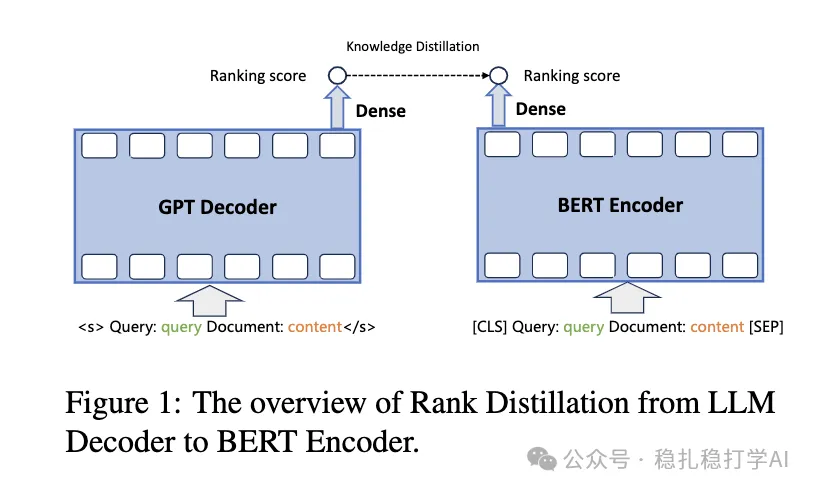
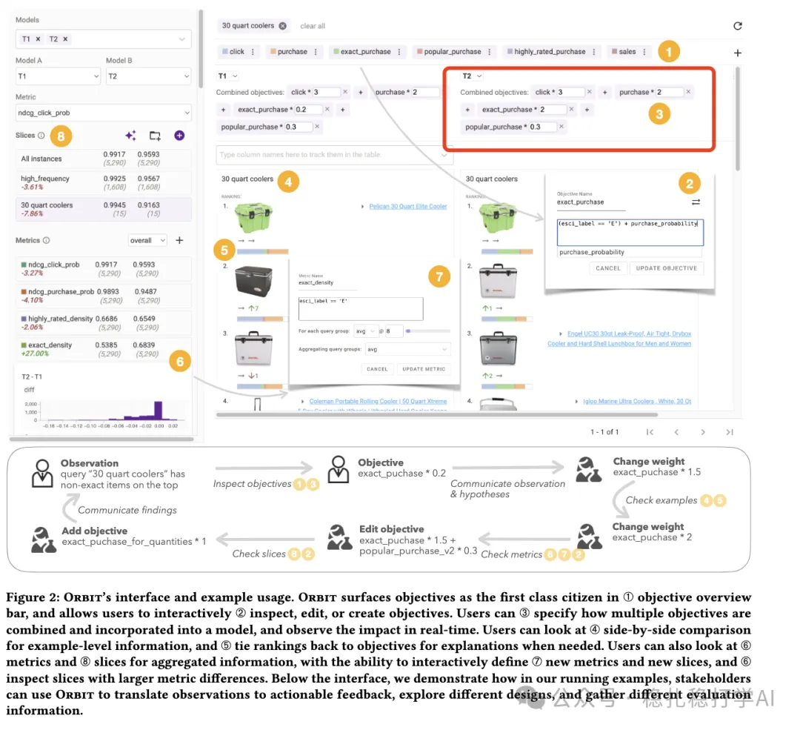

# 推荐算法paper清单（2024.11.08）

> 原文：https://mp.weixin.qq.com/s/eHJwI0FUgcGpofOFvfiSDA
> 作者：算法工程师刘明星（稳扎稳打学AI）| 发表于 2024-11-07

关注我，每天为你精挑细选最优质、最新鲜的推荐算法paper，陪你一起保持进步、不断精进！

> [English version](2024-11-08-three-papers.full.en.md)

1. Best Practices for Distilling Large Language Models into BERT for Web Search Ranking

（1）网址：https://arxiv.org/pdf/2411.04539

（2）公司：腾讯

（3）方向搜索+LLM+迁移学习。

（4）概括：通过迁移学习，将LLM能力迁移到Bert族的小模型上，从而供受限的环境下使用。

（5）心得：大语言模型，在很多工作上，起到协助提升的角色。大家可以平时想想自己的工作，是否能用得上。这个paper简单，抽看看看看。

（6）可信度：生产

（7）推荐等级：推荐看看。

Figure 1: The overview of Rank Distillation from LLM Decoder to BERT Encoder.

2. Self-Calibrated Listwise Reranking with Large Language Models

（1）网址：https://arxiv.org/pdf/2411.04602

（2）公司百度、人大的高瓴。

（3）方向：搜索+rerank。

（4）概括：将大语言模型，应用到搜索rerank环节，实现list-wise的排序。

（5）心得：说个题外话，人大的高瓴人工智能学院，跟工业界互动频繁，发表了大量paper，帮助工业界提升业务，锻炼了学校的师生的能力。不闭门造车，大有硅谷高校的样子，不错哟。

（6）可信度：离线。

（7）推荐等级：有时间再看。

3. Orbit: A Framework for Designing and Evaluating Multi-objective Rankers

（1）网址：https://arxiv.org/pdf/2411.04798

（2）公司：amazon

（3）方向：推荐+Multi-object

（4）概括：如下图，设计了一个MTL模型的交互系统。用户是ranking模型相关的多个部门的、多种角色（算法、产品、运营）的同学，参与到模型的目标优化、评估、探索。比如，rerank的排序融合公式的融合参数，相关的同学，如产品、运营、算法等的，可以通过这个系统，调整融合系数等。

（5）心得：公司大了，涉及的部门和人员特别多，确实需要一个沟通系统。否则，算法工程师，要不断的跟不同的人，沟通各个目标的权重。有了这个系统，就简单多了。

（6）可信度：生产。

（7）推荐等级：有时间再看。

Figure 2: Orbit's interface and example usage. ORBIT surfaces objectives as the first class citizen in ① objective overview bar, and allows users to interactively ② inspect, edit, or create objectives. Users can ③ specify how multiple objectives are combined and incorporated into a model, and observe the impact in real-time. Users can look at ④ side-by-side comparison for example-level information, and ⑤ tie rankings back to objectives for explanations when needed. Users can also look at ⑥ metrics and ⑦ slices for aggregated information, with the ability to interactively define ⑦ new metrics and new slices, and ⑧ inspect slices with larger metric differences. Below the interface, we demonstrate how in our running examples, stakeholders can use ORBIT to translate observations to actionable feedback, explore different designs, and gather different evaluation information.

后记：过去两天没看到好paper，不想浪费大家的时间，不是偷懒哈。
