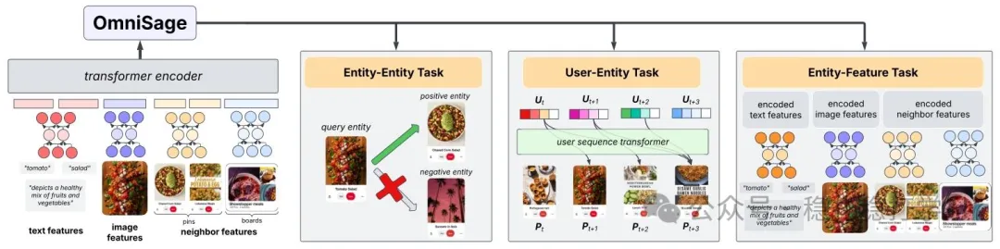

# Recommendation papers (2025.4.28): Pinterest OmniSage, representation learning that unifies graph, sequence and content signals
> [中文版](2025-04-28-pinterest-omnisage.md)

> Source: WeChat post https://mp.weixin.qq.com/s?__biz=MzkzNDYyNjM1NA==&mid=2247484600&idx=1&sn=20790b6a927172aeb58c03d084de83e9&scene=21#wechat_redirect, published 2025-04-28.
> Split from the roundup "Recommendation papers (2025.4.28): Kuaishou and Pinterest, results full of industrial flavor"; same issue: [Pinterest OmniSage graph representation learning](../representation-quality/2025-04-28-pinterest-omnisage.full.en.md), [Kuaishou FIM periodic interest modeling](../behavior-sequence-modeling/2025-04-28-kuaishou-fim-periodic-interest.full.en.md).

Intro of this issue:

Today I introduce two papers: one is Pinterest's graph-learning representation method, the other is Kuaishou's periodic interest modeling.

OmniSage

Link: https://arxiv.org/pdf/2504.17811

Company: Pinterest

Area: graph learning, representation learning

Overview: this method uses a graph neural network (GNN) to model user-item interactions and brings in cross-modal information (such as text and images) to improve the recommender's representation learning.

The core of the method is to integrate information from different modalities into the same graph structure and then use a GNN for representation learning. Specifically, OmniSage builds users, items and their attributes (such as text and images) into a heterogeneous graph, then learns representations of the graph's nodes with a GNN, yielding user and item representations.

OmniSage integrates graph, sequence and content signals through a contrastive learning framework, optimizing the following tasks:

(1) Graph learning: model user-item interactions with a GNN to learn user and item representations.

(2) Sequence modeling: model user behavior sequences with a sequence model to learn the user's dynamic interests.

(3) Content understanding: model items with multimodal information (such as text and images) to learn item representations.

Results:

OmniSage's representation learning improves significantly. Specifically: in scenarios such as Homefeed, Related Pins and board recommendation, OmniSage improves sitewide repins (+1.5%) and surface-specific repins (+2%).

Online results: in online experiments in scenarios such as Homefeed, Related Pins and board recommendation, OmniSage improves sitewide repins (+1.5%) and surface-specific repins (+2%).

Takeaways:

(1) Combining GNNs with multimodal information is a very promising direction.

(2) OmniSage's core innovation is integrating information from different modalities into the same graph structure, achieving efficient representation learning.

Credibility: production

Recommendation: worth reading

