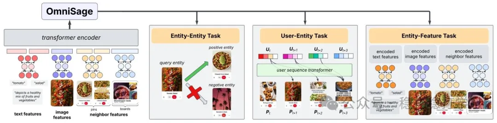

# 推荐算法(2025.4.28)：Pinterest OmniSage，图、序列、内容信号统一的表征学习

> 原文：https://mp.weixin.qq.com/s?__biz=MzkzNDYyNjM1NA==&mid=2247484600&idx=1&sn=20790b6a927172aeb58c03d084de83e9&scene=21#wechat_redirect
> 作者：算法工程师刘明星（稳扎稳打学AI）| 发表于 2025-04-28（修改于 2025-04-28）
> 本文拆自《推荐算法(2025.4.28)：快手、Pinterest的满满工业风成果》，同期 2 篇：[Pinterest OmniSage 图表征学习](../representation-quality/2025-04-28-pinterest-omnisage.md)、[快手 FIM 周期性兴趣建模](../behavior-sequence-modeling/2025-04-28-kuaishou-fim-periodic-interest.md)。

关注我，每天为你精挑细选最优质、最新鲜的推荐算法paper，陪你一起保持进步、不断精进！

> [English version](2025-04-28-pinterest-omnisage.full.en.md)

当期前言：

今天介绍两篇，一篇是Pinterest的图学习表征方法，一篇是快手的周期性兴趣建模。

OmniSage

网址：https://arxiv.org/pdf/2504.17811

公司：Pinterest

方向：图学习、表征学习

解读：这个方法是利用图神经网络（GNN）对用户和物品的交互进行建模，通过引入跨模态信息（如文本、图像等），提升推荐系统的表征学习能力。

这个方法的核心是把不同模态的信息整合到同一个图结构中，然后利用图神经网络进行表征学习。具体来说，OmniSage将用户、物品以及它们的属性（如文本、图像等）构建成一个异构图，然后通过图神经网络对图中的节点进行表征学习，从而得到用户和物品的表征。

OmniSage 通过对比学习框架整合图、序列和内容信号，优化以下任务：

（1）图学习：利用图神经网络对用户和物品的交互进行建模，学习用户和物品的表征。

（2）序列建模：利用序列模型对用户行为序列进行建模，学习用户的动态兴趣。

（3）内容理解：利用多模态信息（如文本、图像等）对物品进行建模，学习物品的表征。

实现了：

OmniSage 的表征学习能力显著提升，具体包括：在 Homefeed、相关 Pin 和板推荐等场景中，OmniSage 提升了全站 repins（+1.5%）和表面特定 repins（+2%）。

上线效果：在线实验：在 Homefeed、相关 Pin 和板推荐等场景中，OmniSage 提升了全站 repins（+1.5%）和表面特定 repins（+2%）。

心得：

（1）图神经网络与多模态信息的结合是一个非常有前景的方向。

（2）OmniSage的核心创新在于将不同模态的信息整合到同一个图结构中，实现了高效的表征学习。

可信度：生产

推荐等级：值得看看

