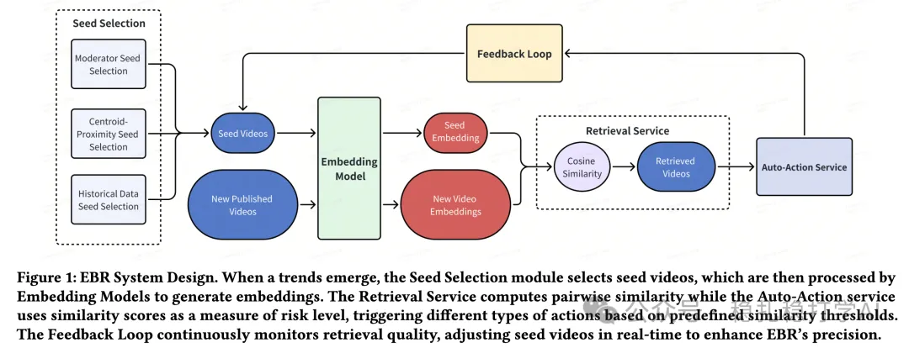

# Recommendation papers (2025.7.3): see how TikTok moderates your videos

> [中文版](2025-07-03-tiktok-content-moderation.md)

1 Improving Content Moderation via Self-Supervised Text and Video Embeddings

Link: https://arxiv.org/pdf/2505.21417

Company: TikTok

Area: content moderation

Overview:

TikTok's content moderation system has to handle a huge volume of video content. Traditional methods rely on human review and simple rules, which are inefficient and error-prone. This paper proposes a self-supervised content moderation method that improves moderation accuracy and efficiency by co-training text and video embeddings.

(1) Self-supervised text embeddings: use text such as video titles and descriptions to generate text embeddings with self-supervised learning. These embeddings capture the semantics of the video content and provide rich features for moderation.

(2) Self-supervised video embeddings: generate video embeddings from video frames and audio. These embeddings reflect the visual and audio features of the video and, combined with the text embeddings, form a multimodal feature representation.

(3) Co-training and fusion: co-train the text and video embeddings, using contrastive learning to optimize the alignment between the two modalities. The fused multimodal features represent the video content more fully and improve the moderation model's performance.

SCL part:

As you can see, it differs from self-supervised contrastive learning: it uses labels.

Takeaways: (1) Applying self-supervised learning to content moderation makes effective use of massive unlabeled data and improves the model's generalization. In particular, co-training multimodal features gives a fuller understanding of video content.

Credibility: production

Recommendation: worth a look

