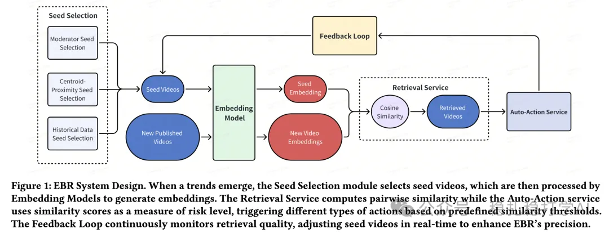

# 推荐算法(2025.7.3)：快看Tiktok是怎么审核你的视频的

> 原文：https://mp.weixin.qq.com/s?__biz=MzkzNDYyNjM1NA==&mid=2247484873&idx=1&sn=cfd6a674121ce40b7de334885b4d4b80&scene=21#wechat_redirect
> 作者：算法工程师刘明星（稳扎稳打学AI）| 发表于 2025-07-03

嘿，记得给“稳扎稳打学AI”添加星标

关注我，每天为你精挑细选最优质、最新鲜的推荐算法paper，陪你一起保持进步、不断精进！

👆 [本公众号paper推荐原则](https://mp.weixin.qq.com/s?__biz=MzkzNDYyNjM1NA==&mid=2247484097&idx=1&sn=18322c279290b555eb030e12953b7c7f&scene=21#wechat_redirect)

1 Improving Content Moderation via Self-Supervised Text and Video Embeddings

网址：https://arxiv.org/pdf/2505.21417

公司：Tiktok

方向：内容审核

解读：

Tiktok的内容审核系统需要处理海量视频内容，传统方法依赖人工审核和简单规则，效率低下且容易出错。本文提出了一种基于自监督学习的内容审核方法，通过文本和视频嵌入的协同训练，提升审核的准确性和效率。

（1）自监督文本嵌入：利用视频标题、描述等文本信息，通过自监督学习方法生成文本嵌入。这些嵌入能够捕捉视频内容的语义信息，为审核提供丰富的特征。

（2）自监督视频嵌入：通过视频帧和音频信息，生成视频嵌入。这些嵌入反映了视频的视觉和听觉特征，与文本嵌入相结合，形成多模态特征表示。

（3）协同训练与融合：将文本嵌入和视频嵌入进行协同训练，通过对比学习方法，优化两种模态之间的对齐。融合后的多模态特征能够更全面地表示视频内容，提升审核模型的性能。

SCL部分：

可见，跟自监督对比学习是有区别的，利用了标签。

心得：（1）自监督学习在内容审核中的应用，能够有效利用海量无标签数据，提升模型的泛化能力。特别是通过多模态特征的协同训练，可以更全面地理解视频内容。

可信度：生产

推荐等级：推荐看看

请帮忙点赞、转发，谢谢。您认为哪篇论文最有潜力应用到实际业务中？

## 欢迎干货投稿 \ 论文宣传 \ 合作交流

推荐您继续阅读：

■ [推荐算法(2025.7.1)：Pinterest的兴趣聚类召回](https://mp.weixin.qq.com/s?__biz=MzkzNDYyNjM1NA==&mid=2247484867&idx=1&sn=33c9c879ca6f9282601c2709750f69dc&scene=21#wechat_redirect)

■ [推荐算法(2025.6.30)：DCN模型的第三版效果不错](https://mp.weixin.qq.com/s?__biz=MzkzNDYyNjM1NA==&mid=2247484859&idx=1&sn=3878da8ba0a3b059a6f1a45888b9f4b3&scene=21#wechat_redirect)

■ [推荐算法(2025.6.29)：本周4篇，效果都不错](https://mp.weixin.qq.com/s?__biz=MzkzNDYyNjM1NA==&mid=2247484855&idx=1&sn=6a3fb2e1a6f0c5e3b0e5d02b8c90e9b&scene=21#wechat_redirect)

历史文章索引：https://docs.qq.com/sheet/DYXZTZ0tseHRyZGtt?tab=BB08J2

由于公众号试行乱序推送，您可能不再准时收到稳扎稳打学AI的推送。为了第一时间收到本号的干货内容， 请将本号设为星标，以及常点文末右下角的“在看”。

喜欢的话点个在看吧👇

个人观点，仅供参考
