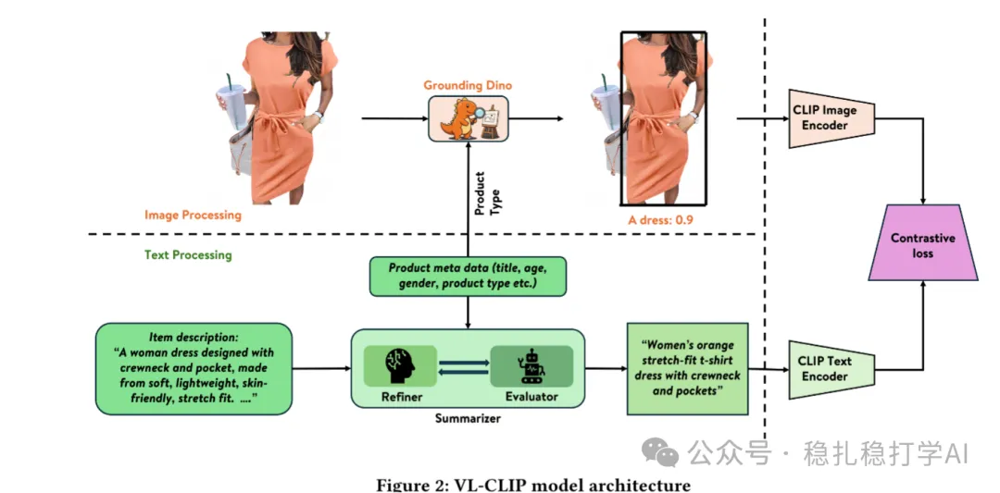

# Recommendation papers (2025.7.24): Walmart crops and crops, and crops out a 10-point GMV jump

> [中文版](2025-07-24-walmart-vl-clip.md)

1 VL-CLIP: Enhancing Multimodal Recommendations via Visual Grounding and LLM-Augmented CLIP Embeddings

Link: https://arxiv.org/pdf/2507.17080

Company: Walmart

Area: search + similar-item recommendation + LLM

Overview:

(Background) The traditional CLIP model faces challenges in e-commerce, such as cluttered product image backgrounds (lifestyle scenes) and redundant text metadata (structured and unstructured information), leading to low recommendation accuracy. The paper proposes a framework that removes noise from the item's image and text using a CV model and an LLM respectively. It has two key components:

(1) Visual grounding

Use the Grounding DINO model to detect and crop the main product in the image, removing background distractions and producing a cleaner visual representation.

Grounding DINO is a CV model that can extract the image regions of specified objects (a list) from a picture.

With two inputs, some of the product's meta information as the specified objects (list) and the product image, it can extract the main subject from the image. The benefit is that irrelevant objects and the background are removed, masking the noise in the image. This is the paper's biggest innovation. Previous work aligned the whole image with the corresponding text.

(2) LLM-enhanced text representation

Use a large language model (LLM, e.g. GPT-4) in a three-step summarize-evaluate-refine chain to generate concise, visually oriented text descriptions (within 20 words), focusing on observable attributes such as color, texture, shape and material. This removes noise from the text (description and title).

Model architecture: a CLIP-based contrastive learning framework that trains the similarity of image and text embeddings, with an HNSW index for efficient retrieval.

It can be used in two business scenarios:

(1) Search: use the query's embedding to search for the top product image embeddings.

(2) Similar-item recommendation: use the embedding of the query product's image to search for products with similar embeddings.

A/B: on the Walmart website, compared with the baseline model, click-through rate (CTR) +18.6%, add-to-cart rate (ATC) +15.5%, gross merchandise value (GMV) +9.9%. It doesn't say which business this is, or whether it is the total of both.

Takeaways:

(1) Using Grounding DINO to crop out noise is a remarkable move. In industry, Grounding DINO is a model proven to be very effective.

(2) Such a large gain is really surprising. Is the noise in the images really that big? If so, this may be why many big companies previously got no gains or only small ones.

Credibility: production

Recommendation: practically useful

