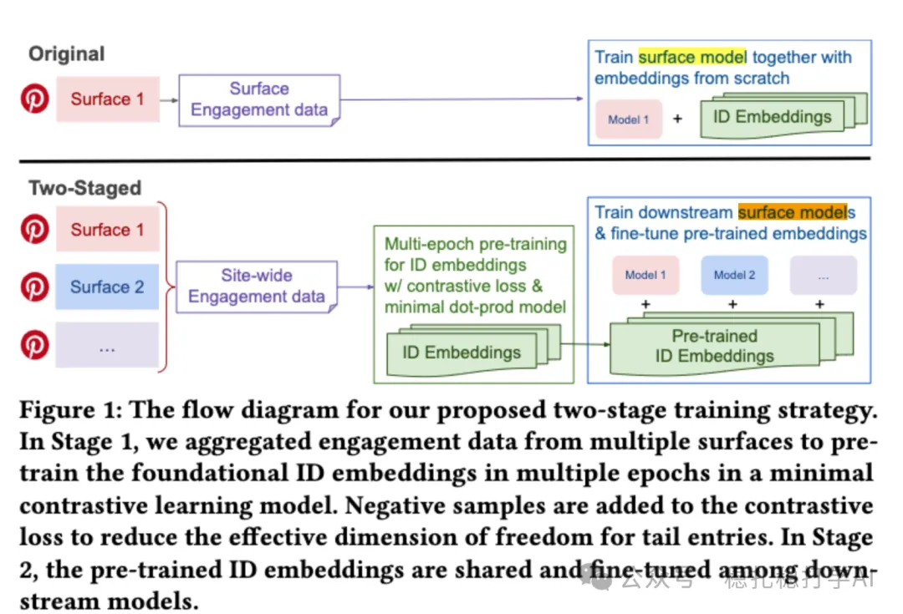

# Recommendation papers (2025.8.28): Pinterest's embedding enhancement method, simple and effective

> [中文版](2025-08-28-pinterest-embed-enhance.md)

1 Taming the One-Epoch Phenomenon in Online Recommendation System by Two-stage Contrastive ID Pre-training

Link: https://arxiv.org/pdf/2508.18700

Company: Pinterest

Area: embedding optimization

Overview:

In short, it pretrains a network that uses only the user ID embedding and the item ID embedding with contrastive learning, and uses the trained embeddings to warm-start later training. The resulting embeddings improve generalization in downstream tasks.

That is, it proposes a new two-stage training strategy: first, a pretraining stage with a minimal dot-product model and a contrastive loss, achieving broader data coverage. Second, these embeddings are fine-tuned in the downstream recommendation task. Specifically,

(1) Minimal dot-product model

It computes the dot product directly from the user embedding and the item embedding, normalizes with a softmax, and optimizes with negative log loss.

(2) Contrastive loss

Negatives are in-batch negatives and uniformly random negatives.

This model can be trained for multiple epochs without overfitting. Why?

(1) There are no complex MLP layers or extra features, so the parameter count is small, which by itself lowers the risk of overfitting (small model capacity, hard to fit noise).

(2) Contrastive learning brings in negatives as constraints, so multi-epoch training does not overfit quickly.

For tail items, traditional BCE optimizes with only a few positives, so the degrees of freedom are too high (e.g., with dimension 100 and 5 samples, the model has 95 "idle" parameters that easily overfit). The contrastive loss brings in many negatives (in-batch + random), giving each positive extra "push away" constraints. This effectively reduces the effective dimensionality of tail items, acting as implicit regularization (like L2 or dropout) and preventing over-personalized embeddings.

In addition, the authors observe in experiments: complex deep CTR models without ID embeddings usually need multiple epochs to converge, but once ID embeddings are added the one-epoch phenomenon appears, and performance ends up worse than the multi-epoch model without IDs.

A/B results:

In a two-week A/B test on Pinterest's Homefeed and Related Pins surfaces, Homefeed engagement time +1.11% and Related Pins save rate +0.72%.

Takeaways:

(1) Pinterest's embedding enhancement method is very interesting. It is much like learning the embeddings of the original CTR model through pretraining, thereby solving the one-epoch problem where multiple epochs actually hurt.

(2) Pinterest is already firmly committed to learning ID embeddings out of band. That's because they found this approach works.

Caveats:

(1) Why do I say this method is interesting? Because learning ID features has always been a hard, long-standing problem in industry. This method decouples embedding learning from CTR model training, which simplifies the problem.

Credibility: production

Credibility: practically useful

