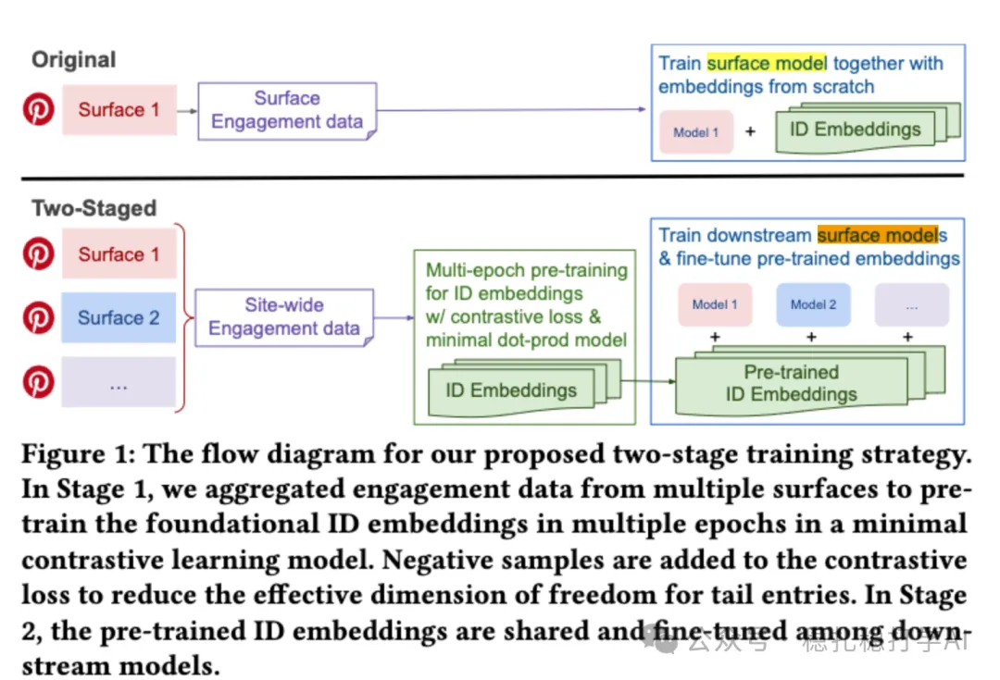

# 推荐算法(2025.8.28)：Pinterest的Embed增强方法，简单有效

> 原文：https://mp.weixin.qq.com/s/EI8CfgZ4EH7sGWs3LwuBNQ
> 作者：算法工程师刘明星（稳扎稳打学AI）| 发表于 2025-08-28（标题已修改；修改于2025年8月31日）

嘿，记得给“稳扎稳打学AI”添加星标

关注我，每天为你精挑细选最优质、最新鲜的推荐算法paper，陪你一起保持进步、不断精进！

👆 [本公众号paper推荐原则](https://mp.weixin.qq.com/s/BhVGu0qH5kTz9N5zpsD3KA)

1 Taming the One-Epoch Phenomenon in Online Recommendation System by Two-stage Contrastive ID Pre-training

网址：https://arxiv.org/pdf/2508.18700

公司：Pinterest

方向：embedding优化

解读：

就是通过对比学习，只用user id embed和item id embed的网络预训练模型，将训练好的embedding为后面训练的预热。生成的嵌入在下游任务中提升了泛化能力。

即提出一种新型两阶段训练策略：首先使用最小点积模型和对比损失进行预训练阶段，实现更广泛的数据覆盖。其次，在下游推荐任务中微调这些嵌入。具体的，

（1）最小点积模型

是基于user embed和item embed直接计算点积，然后通过softmax形式的归一化处理，并使用负对数损失（log loss）进行优化。

（2）对比损失

负样本是in-batch negatives和均匀随机负样本。

这个模型可以做多个epoch的训练，且不会overfit。为什么呢？

（1）没有复杂的MLP层或额外特征，参数量少，本身就降低过拟合风险（模型容量小，不易捕获噪声。

（2）对比学习，引入负样本作为约束，让多周期训练不会快速过拟合。

对于tail项，传统BCE只用少数正样本优化，自由度过高（如维度100，样本5，模型有95个“空闲”参数易过拟合）。对比损失引入大量负样本（批内 + 随机），为每个正样本提供额外“推开”约束。这有效降低tail项的自由度维度（effective dimensionality），相当于隐式正则化（像L2或dropout），防止嵌入过度个性化。

另外，作者通过实验观察到：不含ID嵌入的复杂深度点击率（CTR）模型通常需要多周期收敛，但加入ID嵌入后会出现一周期现象，导致性能不如无ID的多周期模型。

AB效果：

在Pinterest的Homefeed和Related Pins表面进行两周A/B测试，Homefeed +1.11% 互动时间提升，Related Pins +0.72% 保存率提升。

心得：

（1）Pinterest用Embed增强的方法，很有意思。这个方法很像是把原来CTR模型的embedding，通过预训练的方式学出来，从而解决多epoch效果反而下降的one-epoch问题。

（2）Pinterest已经很坚决的，带外学习ID类的embed。这是发现了这种方法work。

愚见：

（1）为什么说这个方法有意思？因为ID类特征的学习一直是工业界老大难问题。这个方法把嵌入学习与CTR模型的训练解耦开了，让问题简单化了。

可信度：生产

可信度：有实践价值

请帮忙点赞、转发，谢谢。您认为哪篇论文最有潜力应用到实际业务中？

## 欢迎干货投稿 \ 论文宣传 \ 合作交流

推荐您继续阅读：

■ [推荐算法(2025.8.27)：Pinterest的条件召回，简单有效](https://mp.weixin.qq.com/s/iwYRuGuSWo4AsEAyxkY5TA)

■ [推荐算法(2025.8.26)：Spotify用大模型分析视频内容](https://mp.weixin.qq.com/s/rxIoz-T7eEy9IR3yuk2P3w)

历史文章索引：https://docs.qq.com/sheet/DYXZTZ0tseHRyZGtt?tab=BB08J2

请入微信群，群内我会给出更深入的解读，还可以共同讨论技术方案、发招聘广告、内推和交友等。

• 铁粉标准：关注一个月以上，且累计10次互动（评论、爱心、转发）、或投稿1次。

• 入群方法：请您加个人微信lmxhappy，我拉您入群，请备注（只我个人看，不公开）。

喜欢的话点个在看吧👇

个人观点，仅供参考

修改于2025年8月31日
