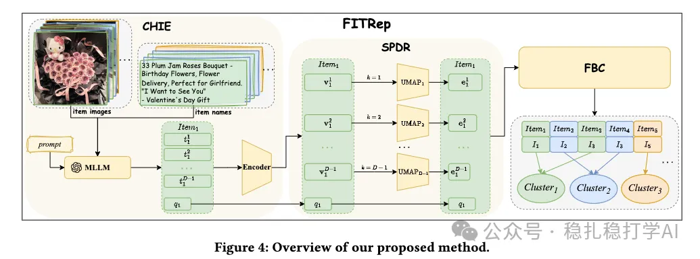

# Recommendation papers (2025.11.28): Meituan, item deduplication, small work, big gains

> [中文版](2025-11-28-meituan-fitrep.md)

1 FITRep: Attention-Guided Item Representation via MLLMs

Link: https://arxiv.org/pdf/2511.21389

Company: Meituan

Idea: more accurate

Area: item deduplication + LLM

Overview:

Overview:

A piece of work on item deduplication. The approach: use a model to identify duplicate items, then merge duplicates into one, which shrinks the item pool and improves recommendation quality.

Specifically,

(1) Use a model to encode an item's title, image, description and other information into a vector;

(2) Use a model to cluster the item vectors into different clusters;

(3) Use a model to identify duplicate items within the same cluster;

(4) Merge duplicate items into one, shrinking the item pool;

(5) Re-encode the merged item into a vector for recommendation.

A/B: Meituan ads CTR +3.60%, CPM +4.25%

Takeaways:

(1) Item deduplication is small work, but the gains are big. On Meituan ads, this paper improved CTR by 3.60% and CPM by 4.25%.

(2) The deduplication method is very simple: use a model to identify duplicate items, then merge them. This method is worth borrowing.

(3) Item deduplication not only shrinks the item pool but also improves recommendation quality, because duplicate items scatter the user's attention and reduce recommendation diversity.

Caveats:

Although the deduplication method is simple, it needs a lot of compute. Especially when the item pool is very large, clustering and deduplication are computationally heavy. How to optimize compute efficiency needs to be considered.

Credibility: production

Recommendation: practically useful

