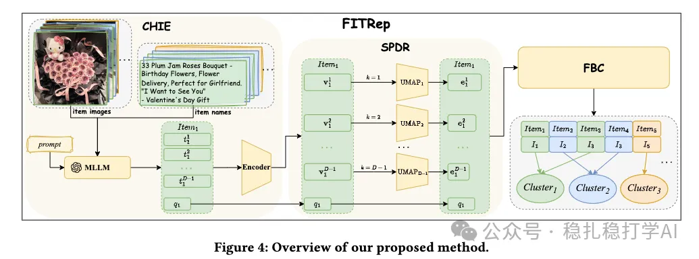

# 推荐算法(2025.11.28)：美团，物料去重，小工作，大效果

> 原文：https://mp.weixin.qq.com/s/5wHgtKr3wLDI-VtVYtjZLQ
> 作者：算法工程师刘明星（稳扎稳打学AI）| 发表于 2025-11-28

嘿，记得给“稳扎稳打学AI”添加星标

关注我，每天为你精挑细选最优质、最新鲜的推荐算法paper，陪你一起保持进步、不断精进！

> [English version](2025-11-28-meituan-fitrep.full.en.md)

👆 [本公众号paper推荐原则](https://mp.weixin.qq.com/s/BhVGu0qH5kTz9N5zpsD3KA)

1 FITRep: Attention-Guided Item Representation via MLLMs

网址：https://arxiv.org/pdf/2511.21389

公司：美团

思想：更准

方向：物料去重+LLM

解读：

解读：

物料去重的一个工作，具体做法是：用一个模型，把重复的物料识别出来，然后把重复的物料合并成一个，从而减少物料库的规模，提高推荐效果。

具体地，

（1）用一个模型，把物料的标题、图片、描述等信息，编码成一个向量；

（2）用一个模型，把物料的向量，聚类成不同的簇；

（3）用一个模型，把同一个簇里的物料，识别出重复的物料；

（4）把重复的物料合并成一个，从而减少物料库的规模；

（5）把合并后的物料，重新编码成一个向量，用于推荐。

AB：美团广告CTR+3.60%，CPM+4.25%

心得：

（1）物料去重是一个小工作，但效果很大。本文在美团广告上，CTR提升了3.60%，CPM提升了4.25%。

（2）物料去重的方法很简单，就是用模型把重复的物料识别出来，然后合并。这个方法值得借鉴。

（3）物料去重不仅可以减少物料库的规模，还可以提高推荐效果，因为重复的物料会分散用户的注意力，降低推荐的多样性。

愚见：

物料去重的方法虽然简单，但需要大量的计算资源。特别是在物料库规模很大的情况下，聚类和去重的计算量很大。需要考虑如何优化计算效率。

可信度：生产

推荐等级：有实践价值

请帮忙点赞、转发，谢谢。

## 欢迎干货投稿 \ 论文宣传 \ 合作交流

推荐您继续阅读：

■ [推荐算法(2025.11.21)：快手，ebr召回，正样本找的真全](https://mp.weixin.qq.com/s/MPWLKFU6d2iYm9TuWPem6g)

■ [推荐算法(2025.11.20)：阿里，用diffusion做特征增强，CTR+2.1%](https://mp.weixin.qq.com/s/Ud2p05jTid8Xc2kk9A1m9A)

历史文章索引：https://docs.qq.com/sheet/DYXZTZ0tseHRyZGtt?tab=BB08J2

请入微信群，群内我会给出更深入的解读，还可以共同讨论技术方案、发招聘广告、内推和交友等。

• 铁粉标准：关注公众号一个月以上，且在公众号上累计15次互动（评论、爱心、转发）、或投稿1次，只欢迎技术同学。

• 入群方法：请您加个人微信lmxhappy，我拉您入群，请备注（只我个人看，不公开）。

喜欢的话点个在看吧👇

个人观点，仅供参考
