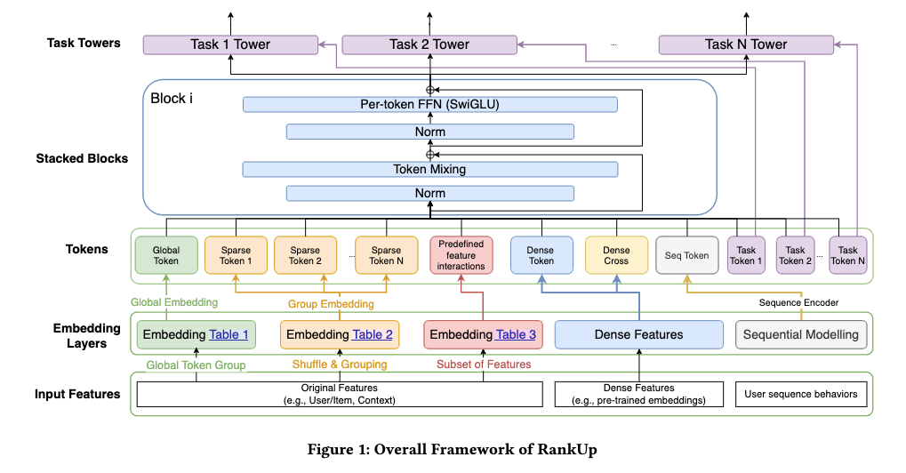

# Tencent tackles "representation collapse" in large-scale ranking models, GMV up to +9.67%

> [中文版](tencent-rankup.md)

### Paper: RankUp: Towards High-rank Representations for Large Scale Advertising Recommender Systems
### Link: https://arxiv.org/html/2604.17878
### Company: Tencent
### Idea: regularization, knowledge distillation, injecting priors
### Area: representation learning
## Overview:
Through 5 enhancement mechanisms at the input stage, it keeps the feature rank of MetaFormer-style models "high at the start and stable in deep layers".

### Background and problem

A new paradigm in recommender systems in recent years replaces the traditional MLP with a Token Mixer (such as Attention or MLP-Mixer); representative works include Hiformer and RankMixer. They can be collectively called MetaFormer-style models. These models have a problem: as network depth grows, rank keeps decaying, and by the last layer a lot of information has been lost and ranking quality drops.

To address this, without changing the MetaFormer backbone (Token Mixer + FFN completely unchanged), the paper proposes 5 complementary high-rank enhancement mechanisms at the stage where input representations are built. These mechanisms effectively raise the initial representation rank and keep deep-layer rank stable, significantly improving the model's AUC and online GMV.

### (1) Random permutation splitting
Randomly shuffle the order of the input sparse feature fields, then group them in the usual way based on the shuffled order to tokenize. This greatly reduces correlation between tokens, letting each token carry more distinctive information. Experiments show this is especially effective for long-tail features; the mutual information matrix shows significantly reduced redundancy.

Randomness is regularization, similar to classic tricks like Dropout, Shuffle Data Augmentation and Random Masking: randomly perturbing the structure of the input forces the model not to rely on any fixed "shortcut" and to learn more robust, more general representations.

Note, someone may ask: don't the downstream layers care about input order?
In a traditional MLP model, the order of feature fields must be fixed. The weights of the first linear (fully connected) layer are bound to positions: feature 17 always corresponds to weight 17. If you shuffle the feature order, the model effectively "mistakes who's who", the weights no longer match at all, and the model fails completely.

But in MetaFormer-style models, the Token Mixer after tokenization works like this: it treats the T tokens as an unordered set and does symmetric mixing across all tokens. What it learns is "how any two tokens should interact", not "token 3 must interact with token 5". This design is inherently permutation-invariant, or gains robustness to arbitrary order through learning.

Note that only this mechanism is strictly for sparse features; the scope of the other 4 mechanisms below is not limited to sparse features.

### (2) Multi-embedding representation
Each sparse feature no longer uses just 1 embedding table but K independent embedding tables (K>1). The multiple embedding vectors are concatenated or aggregated when the token is formed, giving a high-dimensional, redundant initialization and a richer starting point for later layers.

**Design idea**: redundancy is not waste but insurance. Several independent views of the same feature → a more complete feature representation → higher initial rank.

### (3) Global token integration
Introduce a global token built by explicitly pooling all features, which takes part in the whole MetaFormer computation together with all local feature tokens. This way every local token can interact directly with the global context in every Token Mixer layer, forming an efficient "global-local" information flow and significantly easing rank shrinkage in deep FFNs.

**Design idea**: avoid information silos. A single token's information may decay, but the global token acts as an "information hub", ensuring the deep network always has a high-dimensional "reference point".

### (4) Cross-domain pretrained embedding crossing
Take user embeddings and item embeddings pretrained in other domains, multiply them element-wise (simulating feature-level interaction), then apply a linear projection to get a new token. This injects external prior knowledge and further enriches the initial representation space.

**Design idea**: knowledge distillation and transfer learning. Instead of relearning, directly use the user/item semantics already learned in other domains to quickly raise the current domain's initial rank.

### (5) Task-specific token decoupling
For each task, introduce a learnable dedicated token (which takes part in all L layers together with the shared tokens). The task-specific token evolves independently inside the shared backbone, reducing gradient interference and letting each task make full use of the high-rank representation space. During training it is "pulled specifically" by its task's gradients, gradually acquiring representation information specific to that task.

**Key point**: the task-specific token **is added from the input layer**, goes through all L MetaFormer layers together with the shared tokens, and is only used by its task tower at the end. It is not a "late patch" but a dedicated representation carrier that "comes along the whole way".

**Design idea**: decoupling in multi-task learning. Avoid mutual interference between gradients of different tasks; each task has its own representation channel and better preserves its own rank.

### Supplement: a plain explanation of rank and erank

**What is rank?** A measure of how "distinctive" the feature information is

Imagine you have 10 recommendation engineers:
- **Low rank**: all 10 come from the same school, same major, same background → their ideas overlap heavily; there are 10 people but only the equivalent of "1 distinct line of thinking"
- **High rank**: the 10 come from different fields, backgrounds and experiences → each has a distinct perspective and can propose 10 different solutions → rich information, strong complementarity

**Why care about rank?** In deep learning, low rank means features are redundant and wasted; high rank means rich, usable information.

**What is erank?** "Effective rank", measuring the dimensions that are actually doing work

You may have 100-dimensional features, but maybe only 20 dimensions are really working (large gradients, active updates), while the other 80 are "dozing off". **erank ≈ 20**.

### A/B:
The paper has been validated in full online deployment, bringing GMV gains of 2.12% to 4.81% across three major WeChat surfaces (Channels / Official Accounts / Moments), and as high as 9.67% in cold-start scenarios.

## Takeaways:
* Follow up on well-known models from well-known companies, dig into every component of the model, find problems, solve them, and get good results. This is a better working path than building a model from scratch. This paper is clearly tracking RankMixer: it found that rank gets low as the number of layers grows, and proposed targeted solutions. None of the 5 mechanisms is so fancy that an ordinary algorithm engineer couldn't think of it.

## Caveats
* The method applies to MetaFormer-style models, not to ranking models with an MLP backbone.

## Credibility: production

## Recommendation: practically useful

