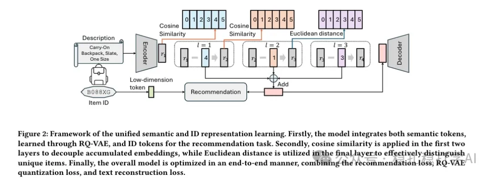

# Recommendation papers (2025.2.25): Meta unifies semantic and ID representations with a dual VAE
> [中文版](2025-02-25-meta-unified-semantic-id.md)

> Source: WeChat post https://mp.weixin.qq.com/s?__biz=MzkzNDYyNjM1NA==&mid=2247484189&idx=1&sn=c256db252d5aa7ce3629b8c45953a2d5&scene=21#wechat_redirect, published 2025-02-25.
> Split from the roundup "Recommendation papers, fast! The latest practical results from four big companies"; same issue: [Meta unified semantic and ID representation](../sid/2025-02-25-meta-unified-semantic-id.full.en.md), [Google LR-Recsys contrastive explanations](../llm4rec/2025-02-25-google-llm-contrastive-explanations.full.en.md), [Huawei SCCDR cross-domain contrastive learning](../cross-domain-recommendation/2025-02-25-huawei-separated-contrastive-cdr.full.en.md), [Alibaba ESANS semantic-aware negative sampling](../deep-retrieval/2025-02-25-ali-esans-negative-sampling.full.en.md).

Intro of this issue:

This post focuses on frontier research in recommender systems, covering LLM recommendation, cross-domain recommendation, and embedding-based retrieval. It walks through four papers from well-known companies and gives takeaways and recommendation levels.

Unified Semantic and ID Representation Learning for Deep Recommenders

Link: https://arxiv.org/abs/2502.16474

Company: Meta

Area: LLM recommendation

Overview: It introduces a unified semantic and ID representation learning method, proposing a new framework that combines semantic information with ID representations to strengthen the model's representational power. At the same time, with the help of an LLM (large language model), the semantic and ID representations are expressed in a unified way, closing the gap between them.

Concretely, the core idea of the framework is to unify semantic and ID representations with a dual-VAE architecture, representing both as discrete indices, similar to RQ-VAE https://arxiv.org/pdf/2305.05065. On top of this, different combinations can be used to strengthen the model's representational power and thus improve recommendation quality.

Takeaways: This is yet another work that unifies and strengthens the two; this approach has been popular lately.

Credibility: offline

Recommendation: worth reading

Figure 2: Framework of the unified semantic and ID representation learning. The dual VAE encodes semantic and ID representations into the same space and generates the latent representations for each item.
