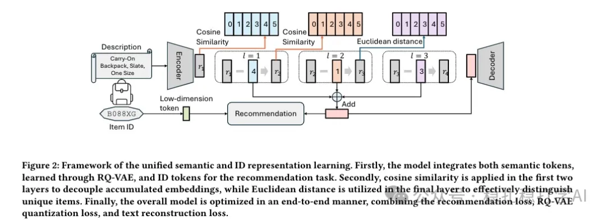

# 推荐算法(2025.2.25)：Meta用对偶 VAE 统一语义表征与 ID 表征

> 原文：https://mp.weixin.qq.com/s?__biz=MzkzNDYyNjM1NA==&mid=2247484189&idx=1&sn=c256db252d5aa7ce3629b8c45953a2d5&scene=21#wechat_redirect
> 作者：算法工程师刘明星（稳扎稳打学AI）| 发表于 2025-02-25
> 本文拆自《推荐算法paper速冲！四大厂最新实用科技成果》，同期 4 篇：[Meta 语义与 ID 统一表征](../sid/2025-02-25-meta-unified-semantic-id.md)、[Google LR-Recsys 对比解释](../llm4rec/2025-02-25-google-llm-contrastive-explanations.md)、[华为 SCCDR 跨域对比学习](../cross-domain-recommendation/2025-02-25-huawei-separated-contrastive-cdr.md)、[阿里 ESANS 语义感知负采样](../deep-retrieval/2025-02-25-ali-esans-negative-sampling.md)。

关注我，每天为你精挑细选最优质、最新鲜的推荐算法paper，陪你一起保持进步、不断精进！

> [English version](2025-02-25-meta-unified-semantic-id.full.en.md)

当期前言：

这篇文章主要聚焦于推荐系统领域的前沿研究，涉及 LLM 推荐、跨域推荐和向量召回等方向，解读了四篇来自知名企业的论文，并给出了心得和推荐等级。

Unified Semantic and ID Representation Learning for Deep Recommenders

网址：https://arxiv.org/abs/2502.16474

公司：meta

方向：LLM推荐

解读：通过引入统一的语义与 ID 表征学习方法，提出了一个新的框架，将语义信息与 ID 表征结合，增强了模型的表示能力。同时，在 LLM（大语言模型）的帮助下，将语义表征和 ID 表征进行统一表示，弥补了语义表征和 ID 表征的差异。

具体来说，这个框架的核心思想是通过对偶 VAE 的架构来统一语义和 ID 的表示，将语义表征和 ID 表征都表示为离散的索引，类似于 RQ-VAE https://arxiv.org/pdf/2305.05065。基于此，可以通过不同的组合方式增强模型的表示能力，从而提升推荐效果。

心得：这又是一篇将两者统一、增强的作品，这个做法最近很流行。

可信度：离线

推荐等级：值得看看

Figure 2: Framework of the unified semantic and ID representation learning. The dual VAE encodes semantic and ID representations into the same space and generates the latent representations for each item.
