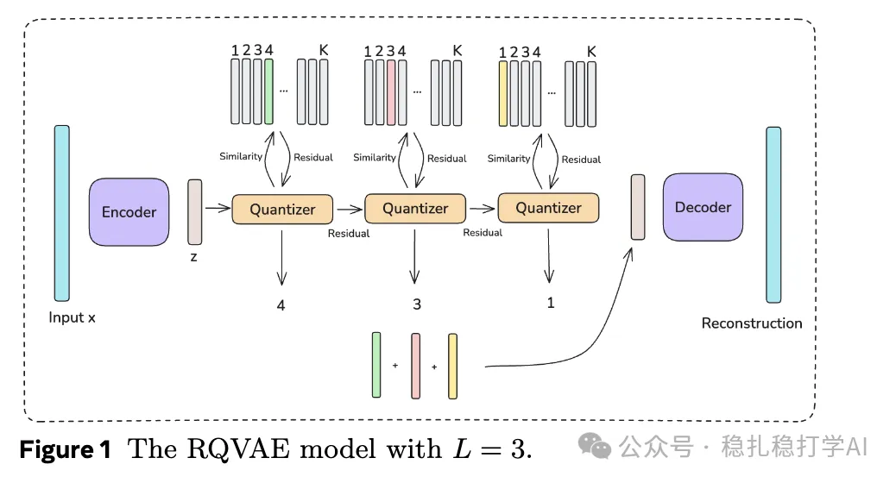

# Recommendation Papers (2025.4.5): Meta shows that similar items improve recommendation

> [中文版](2025-04-04-meta-semantic-id.md)

Semantic IDs Are Not Created Equal: Enhancing Generative Retrieval and Ranking with Semantic ID Embeddings

Link: https://arxiv.org/pdf/2504.00570

Company: Meta

Area: semantic IDs

Overview:

The Semantic ID method in the paper first uses a content understanding model to produce an item embedding (a dense feature vector), then uses RQ-VAE (residual-quantized variational autoencoder) to hierarchically cluster these embeddings, producing semantically meaningful code sequences. This clustering essentially groups similar embeddings together, forming a semantically meaningful ID space.

How it works:

(1) Content understanding and embedding generation: a content understanding model extracts embeddings from an item's multimodal content (text, images, audio, etc.). These embeddings capture the item's semantic information (category, brand, style, etc.) and are the basis for the clustering that follows.

(2) Prefix-ngram parameterization: for the code sequence generated for a Semantic ID, generate all prefix subsequences. For example, with L=3:

(c1): the coarsest cluster. (c1,c2): medium granularity. (c1,c2,c3): the finest granularity. These prefixes are mapped to different rows of the embedding table, and the final embedding vector is produced by sum-pooling.

Takeaways: this is an application of embedding clustering, here applied to item embeddings.

The Semantic ID method in the paper first uses a content understanding model to produce an item embedding (a dense feature vector), then uses RQ-VAE (residual-quantized variational autoencoder) to hierarchically cluster these embeddings, producing discrete code sequences. This clustering essentially groups similar embeddings together, forming a semantically meaningful ID space.

Why cluster embeddings?

(1) From continuous to discrete: embeddings are continuous vector representations, and using them directly may require huge embedding tables (especially when there are a great many items). Clustering (RQ-VAE quantization) turns them into discrete code sequences, which compresses the representation space while keeping the semantic information.

(2) Semantic grouping: random hashing is blind, while embedding clustering is based on semantic similarity (e.g. pizza ads get clustered together), so new items or long-tail items can "borrow" the training data of similar items, improving generalization.

(3) Stability: the Semantic IDs produced by hierarchical clustering are more stable over time (even if item IDs drift, the semantic category stays the same), which solves the problem in traditional methods of embedding representations changing over time.

Generality of the method: although this is clustering of item embeddings, a similar idea can extend to other areas. For example, clustering user embeddings to produce "semantic user IDs", or clustering interaction events to produce "semantic behavior IDs". This suggests that embedding clustering is a general representation learning tool.

Credibility: production

Recommendation: strongly recommended

