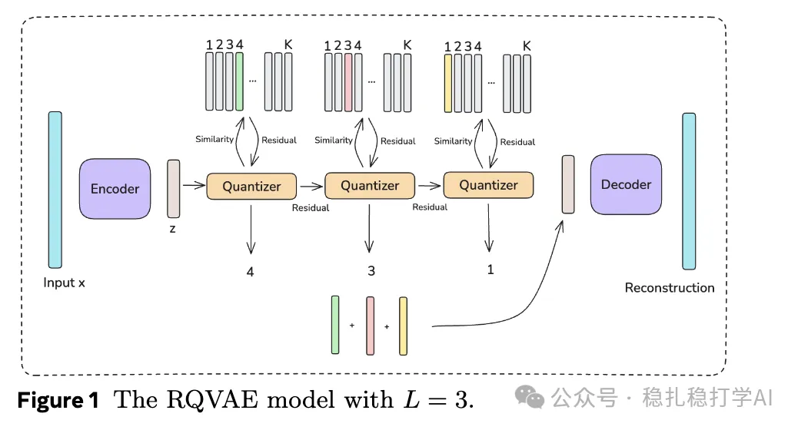

# 推荐算法(2025.4.5)：meta证明相似物料提升推荐效果

> 原文：https://mp.weixin.qq.com/s?__biz=MzkzNDYyNjM1NA==&mid=2247484406&idx=1&sn=df1c19f10bd1a1e7d039d0a1e8c8fef7&scene=21#wechat_redirect
> 作者：算法工程师刘明星（稳扎稳打学AI）| 发表于 2025-04-04

嘿，记得给“稳扎稳打学AI”添加星标

关注我，每天为你精挑细选最优质、最新鲜的推荐算法paper，陪你一起保持进步、不断精进！

📄 [本公众号paper推荐原则](https://mp.weixin.qq.com/s?__biz=MzkzNDYyNjM1NA==&mid=2247484097&idx=1&sn=18322c279290b555eb030e12953b7c7f&scene=21#wechat_redirect)

Semantic IDs Are Not Created Equal: Enhancing Generative Retrieval and Ranking with Semantic ID Embeddings

网址：https://arxiv.org/pdf/2504.00570

公司：Meta

方向：语义ID

解读：

论文中的 Semantic ID 方法首先通过内容理解模型生成物品（item）的 embedding（密集特征向量），然后利用 RQ-VAE（残差量化变分自编码器）对这些 embedding 进行层次聚类，生成语义上有意义的编码序列。这种聚类过程本质上是将相似的 embedding 分组，从而形成语义上有意义的 ID 空间。

具体做法：

（1）内容理解与嵌入生成：使用内容理解模型从物品的文本、图像、音频等多模态内容中提取 embedding。这些 embedding 捕捉了物品的语义信息（如类别、品牌、风格等），为后续的聚类提供了基础。

（2）Prefix-ngram 参数化：对Semantic ID的生成编码序列，生成所有前缀子序列，例如对于 L=3 :

(c1)：最粗粒度的聚类。(c1,c2)：中等粒度。(c1,c2,c3)：最细粒度。这些前缀被映射到嵌入表的不同行，并通过求和池化（sum-pooling）生成最终的嵌入向量。

心得：这是借助embed聚类的一个应用，这里是item的embed。

论文中的 Semantic ID 方法首先通过内容理解模型生成物品（item）的 embedding（密集特征向量），然后利用 RQ-VAE（残差量化变分自编码器）对这些 embedding 进行层次聚类，生成离散的编码序列。这种聚类过程本质上是将相似的 embedding 分组，从而形成语义上有意义的 ID 空间。

为什么用 embedding 聚类？

（1）从连续到离散：embedding 是连续的向量表示，直接使用可能需要巨大的嵌入表（尤其在物品数量极多时）。通过聚类（RQ-VAE 量化），将其转化为离散的编码序列，既压缩了表示空间，又保留了语义信息。

（2）语义分组：随机哈希是盲目的，而 embedding 聚类基于语义相似性（例如披萨广告被聚到一起），使得新物品或长尾物品可以“借用”相似物品的训练数据，提升泛化能力。

（3）稳定性：层次聚类生成的 Semantic ID 在时间维度上更稳定（即使物品 ID 漂移，语义类别不变），这解决了传统方法中嵌入表示随时间变化的问题。

方法的普适性：虽然这里是对 item embedding 的聚类，但类似思路可以扩展到其他领域。例如，对用户 embedding 聚类生成“语义用户 ID”，或者对交互事件聚类生成“语义行为 ID”。这提示我们，embedding 聚类是一种通用的表示学习工具。

可信度：生产

推荐等级：强烈推荐看看

请帮忙点赞、转发，谢谢。您认为哪篇论文最有潜力应用到实际业务中？

## 欢迎干货投稿 \ 论文宣传 \ 合作交流

推荐您继续阅读：

■ [推荐算法(2025.4.3)：意图建模是LLM赋能搜广推的重要方式](https://mp.weixin.qq.com/s?__biz=MzkzNDYyNjM1NA==&mid=2247484400&idx=1&sn=9097b2a31975d4b210324c72e4d1ff2e&scene=21#wechat_redirect)

■ [推荐算法(2025.4.1)：工业风拉满！Meta、百度、微软的成果](https://mp.weixin.qq.com/s?__biz=MzkzNDYyNjM1NA==&mid=2247484391&idx=1&sn=ef838380260b349648ae9d9bc69b52ab&scene=21#wechat_redirect)

■ [推荐算法(2025.3.31)：阿里的思维链尝试](https://mp.weixin.qq.com/s?__biz=MzkzNDYyNjM1NA==&mid=2247484381&idx=1&sn=bdd18a629eb6c668c3ad9002f10c77c3&scene=21#wechat_redirect)

历史文章索引：https://docs.qq.com/sheet/DYXZTZ0tseHRyZGtt?tab=BB08J2

由于公众号试行乱序推送，您可能不再准时收到稳扎稳打学AI的推送。为了第一时间收到本号的干货内容， 请将本号设为星标，以及常点文末右下角的“在看”。

喜欢的话点个在看吧 👇

个人观点，仅供参考
