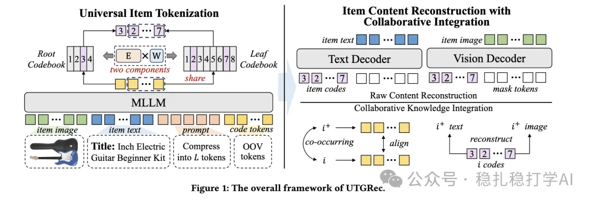

# Recommendation Papers (2025.4.10): Tencent shows for the third time that similar items improve recommendation

> [中文版](2025-04-10-tencent-utgrec.md)

Universal Tokenization for Generative Recommendation (UTGRec)

Link: https://arxiv.org/pdf/2504.03680

Company: Tencent

Area: LLM-based recommendation + multimodal

Overview:

The paper proposes a method for turning multimodal embeddings into discrete IDs (called codes): a tree-structured codebook. Through joint reconstruction of text, images, codebook and so on, it trains the multimodal embeddings and the codebook jointly. The resulting code sequence serves as the item's identifier for downstream LLM generative recommendation.

The focus of this paper is the tree-structured codebook: in essence it is a boosting-style discretization method, not a tree in the usual sense. Specifically, for the code sequence output by the LLM, each later one minus the previous one (except the first) gives an embedding, which is looked up in the codebook to find the corresponding ID. The first position uses one codebook for the "translation"; to reduce the number of weights and share knowledge, the codes at all other positions share one codebook. In other words, there are only two codebooks.

I won't go into the reconstruction part. Note that this work and the LLM generative recommendation are two separate stages.

Some background:

In the generative recommendation paradigm, item tokenization turns the traditional next-item prediction task into a sequence-to-sequence generation task:

1) The user's historical interaction sequence (e.g. an item ID sequence [i1,i2,…,in]) is converted into the corresponding code sequence (e.g. [c1,c2,…,cn]).

2) The recommendation model (usually a generative model such as a Transformer) predicts and generates the target item's code sequence (e.g. [cn+1,…,cn+L]) from the historical code sequence. Decoding these codes identifies the recommended item.

Mapping continuous semantic representations into a discrete code space is usually done with a codebook. A codebook is a predefined set of vectors, each corresponding to one code. Existing discretization methods include Vector Quantization (VQ) and K-means clustering.

Takeaways:

(1) Similar-item augmentation for the items in the sequence.

Like the clustering or quantization results of K-means and VQ, this method is a generalized clustering over all items, where each vector stands for a group of semantically similar item features.

(2) Reconstruction and alignment are already the basic work when using multimodal signals for recommendation.

Credibility: offline

Recommendation: practically useful (worth trying on your own business)

Figure 1: The overall framework of UTGRec.
