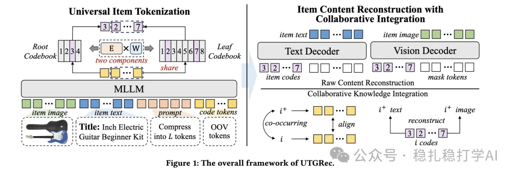

# 推荐算法(2025.4.10)：腾讯第三次证明相似物料提升推荐效果

> 原文：https://mp.weixin.qq.com/s?__biz=MzkzNDYyNjM1NA==&mid=2247484439&idx=1&sn=7e51fbafb8826568be5fd537a0cd83aa&scene=21#wechat_redirect
> 作者：算法工程师刘明星（稳扎稳打学AI）| 发表于 2025-04-10（标题已修改；修改于 2025-04-10）

嘿，记得给“稳扎稳打学AI”添加星标

关注我，每天为你精挑细选最优质、最新鲜的推荐算法paper，陪你一起保持进步、不断精进！

📄 [本公众号paper推荐原则](https://mp.weixin.qq.com/s?__biz=MzkzNDYyNjM1NA==&mid=2247484097&idx=1&sn=18322c279290b555eb030e12953b7c7f&scene=21#wechat_redirect)

Universal Tokenization for Generative Recommendation (UTGRec)

网址：https://arxiv.org/pdf/2504.03680

公司：腾讯

方向：LLM推荐+多模态

解读：

提出了一种将多模态的embed转成离散ID（称之为code、代码）的方法——树状结构码本，并通过文本、图、码本等联合重建，实现了多模态embed和码本的联合训练。得到的代码序列作为物品的标识符，用于后续的LLM生成式推荐。

本文的重点是树状结构码本：本质上，是一个boost方法的离散方法，其实，不是常规理解的树。具体的，对LLM输出的code序列，后者减去前者（第一个除外），获得的embed，在码本里搜出对应的ID。第一个用一个码本做'翻译'，为了减少weights量和知识共享，其它位置的code，共用一个码本。换句话说，只有两个码本。

重建工作就不展开了。注意，本工作与LLM生成式推荐是两阶段的。

补充一下背景知识：

在生成推荐范式中，物品分词将传统的下一物品预测任务（next-item prediction）转化为序列到序列（sequence-to-sequence）的生成任务：

1）用户的历史交互序列（如物品 ID 序列 [i1,i2,…,in] 被转化为对应的代码序列（如 [c1,c2,…,cn]）。

2）推荐模型（通常是生成模型，如 Transformer）根据历史代码序列，预测并生成目标物品的代码序列（如 [cn+1,…,cn+L]）。通过解码这些代码，可以确定推荐的物品。

其中，将连续的语义表示映射到离散的代码空间，通常通过码本（codebook）实现。码本是一个预定义的向量集合，每个向量对应一个代码。已有的离散化的方法包括矢量量化（Vector Quantization, VQ）、K-means 聚类。

心得：

（1）对序列item做相似item增强。

跟 K-means 和 VQ 的聚类或量化结果类似，本文方法是对所有对物品的一种广义的聚类，每个向量代表一组语义相似的物品特征。

（2）重建、对齐已经是多模态用于推荐的基本工作。

可信度：离线

推荐等级：有实践价值——可以在自己的业务上试试

Figure 1: The overall framework of UTGRec.

请帮忙点赞、转发，谢谢。您认为哪篇论文最有潜力应用到实际业务中？

## 欢迎干货投稿 \ 论文宣传 \ 合作交流

推荐您继续阅读：

■ [推荐算法(2025.4.9)：快手再次证明相似物料提升推荐效果](https://mp.weixin.qq.com/s?__biz=MzkzNDYyNjM1NA==&mid=2247484431&idx=1&sn=c0598c45d25962ffad3b9f281d169f1e&scene=21#wechat_redirect)

■ [推荐算法(2025.4.8)：魔鬼藏在细节里](https://mp.weixin.qq.com/s?__biz=MzkzNDYyNjM1NA==&mid=2247484424&idx=1&sn=103d2fab460bb03ccfd332c5f1c2f0a3&scene=21#wechat_redirect)

■ [推荐算法周报(2025.4.6)：更准确](https://mp.weixin.qq.com/s?__biz=MzkzNDYyNjM1NA==&mid=2247484418&idx=1&sn=686aa6adffeb2f91ec32f8f32b379f40&scene=21#wechat_redirect)

历史文章索引：https://docs.qq.com/sheet/DYXZTZ0tseHRyZGtt?tab=BB08J2

由于公众号试行乱序推送，您可能不再准时收到稳扎稳打学AI的推送。为了第一时间收到本号的干货内容， 请将本号设为星标，以及常点文末右下角的“在看”。

喜欢的话点个在看吧 👇

个人观点，仅供参考

修改于2025年4月10日
